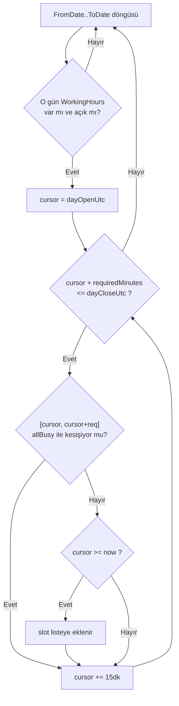

# M5 — Availability Engine (As-Built)

> **Durum:** Bu spec mevcut implementasyonu belgeler (as-built, 2026-07-23) — tasarım hedefi değil, kodun ne yaptığının kaydıdır. Açık gap'ler için `docs/GAP-ANALYSIS.md` §3-5; bu dokümanda ilgili madde numaraları işaretli.
> **Kapsam:** `backend/src/Kuaforum.Application/Modules/Availability/` (`ComputeAvailabilityQuery`, `StylistScheduleChecker`), `backend/src/Kuaforum.Domain/Modules/Availability/Slot.cs`, `backend/src/Kuaforum.Domain/Modules/Barber/WorkingHours.cs`.
> **Bağımlılık:** M4 Barber (`Stylist`, `WorkingHours`, `TimeOff`, `ServiceCatalog`), M6 Booking (`IBusyRangeQuery` gerçek implementasyonu).

---

## 1. Amaç

Bir stilist için verilen tarih aralığında, seçilen hizmet(ler)in toplam süresine göre **rezerve edilebilir slot listesi** üretir (`ComputeAvailabilityQuery`) ve tek bir slot'un rezerve edilebilir olup olmadığını booking-time'da doğrular (`StylistScheduleChecker`). İki ayrı kod yolu aynı iş kuralını (working hours + time-off + busy-range kesişimi) farklı granülaritede uygular — biri liste üretir (müşteri "hangi saatler boş" görür), diğeri tek noktayı doğrular (booking sırasında son kontrol).

## 2. Slot Grid Algoritması

`ComputeAvailabilityQueryHandler.Handle` (`ComputeAvailabilityQuery.cs:26-100`):

1. **Girdi doğrulama:** `ToDate >= FromDate`, aralık ≤60 gün (`:28-33`), ≥1 `ServiceCatalogId` (`:35-36`).
2. **Stilist + hizmet çözümleme:** `Stylist.IsActive` şart (`:40-41`); seçilen `ServiceCatalogId`'lerin tümü aynı `BarberShopId`'ye ait ve `IsActive` olmalı, aksi halde eksik-hizmet hatası (`:44-51`).
3. **Toplam süre:** `requiredMinutes = Σ DurationMinutes + Σ BufferMinutes` (hizmetler arası hazırlık payı) — sıfır veya negatifse reddedilir (`:53-58`).
4. **Meşgul aralıklar:** `TimeOff` (Europe/Istanbul aralığı UTC'ye çevrilmiş `[fromUtc, toUtc)`) + `IBusyRangeQuery.GetBusyRangesAsync` (gerçek implementasyon = booking'ler, bkz. §5) birleştirilip zaman sırasına göre sıralanır (`:60-74`).
5. **Grid üretimi:** Her gün için `WorkingHours` sözlüğünden o günün `OpenTime`/`CloseTime`'ı okunur (kapalıysa gün atlanır); `cursor` gün açılışından başlayıp **15 dakikalık artışlarla** (`SlotIncrement = TimeSpan.FromMinutes(15)`, `:23`) ilerler; her adımda `cursor + requiredMinutes <= dayEnd` olduğu sürece bir aday slot hesaplanır; aday, `allBusy` listesindeki herhangi bir aralıkla kesişmiyorsa **ve** `cursor >= DateTimeOffset.UtcNow` (geçmiş slot listelenmez) ise sonuca eklenir (`:78-97`).



**Çıktı:** `SlotDto(StartsAt, EndsAt)` listesi, dakika hassasiyetli (`ComputeAvailabilityQuery.cs:16`).

## 3. Europe/Istanbul TZ Dönüşümü

Tüm zaman hesapları DB'de **UTC** saklanır (`DateTimeOffset`); yerel gün sınırları (`WorkingHours.OpenTime`/`CloseTime`, `TimeOnly`) İstanbul saatinde tanımlıdır. Dönüşüm iki yerde birebir tekrarlanan bir `ToUtc` yardımcı fonksiyonuyla yapılır:

```csharp
// ComputeAvailabilityQuery.cs:102-106 ve StylistScheduleChecker.cs:53-57 (aynı mantık, ayrı kopya)
private static DateTimeOffset ToUtc(DateOnly date, TimeOnly time)
{
    var local = new DateTime(date.Year, date.Month, date.Day, time.Hour, time.Minute, 0, DateTimeKind.Unspecified);
    return new DateTimeOffset(local, IstanbulTz.GetUtcOffset(local)).ToUniversalTime();
}
```

`IstanbulTz = TimeZoneInfo.FindSystemTimeZoneById("Europe/Istanbul")` her iki dosyada da ayrı `static readonly` alan (`ComputeAvailabilityQuery.cs:24`, `StylistScheduleChecker.cs:10`) — kod tekrarı, ortak bir `ITimeZoneProvider`/sabit yok.

**DST notu:** Türkiye 2016'dan beri **DST uygulamıyor** (`UTC+3` sabit) — `[unverified 2026-07-23 — TSİ/DST kural değişikliği ihtimaline karşı resmi kaynaktan teyit edilmeli]`. Kod `TimeZoneInfo.GetUtcOffset` kullandığı için OS'un tz database'i güncellenirse otomatik doğru davranır, ancak **DST-geçiş edge-case'i için hiçbir test yok** (GAP-ANALYSIS'te ayrı madde olarak geçmiyor ama test envanterinde de yok — bu spec'in kod taramasından yeni bulgu, bkz. rapor).

## 4. StylistScheduleChecker — Booking-Time Doğrulama

`StylistScheduleChecker.EnsureSlotIsBookableAsync` (`StylistScheduleChecker.cs:12-51`) — `ComputeAvailabilityQuery`'nin grid üretiminden **bağımsız**, tek bir `[slotStart, slotEnd)` aralığını doğrulayan ayrı kod yolu:

1. `slotEnd > slotStart` (`:18-19`).
2. Slot tek bir yerel günde başlayıp bitmeli — gece yarısını geçen randevu reddedilir (`:23-27`).
3. O günün `WorkingHours`'ı yoksa veya `IsClosed` ise reddedilir (`:30-34`).
4. Slot, o günün `[OpenTime, CloseTime]` aralığının **tamamen içinde** olmalı (`:40-41`).
5. `TimeOff` ile kesişim varsa `409 Conflict` (`:43-48`).

**Nerede enforce edildiği:** `InitiateBookingCommandHandler` (`InitiateBookingCommand.cs:70-72`) ve `RescheduleBookingCommandHandler` (`RescheduleBookingCommand.cs:72-74`) — her iki komut da booking'i domain'e yazmadan önce bu kontrolü çağırır. **Bilerek yapılmayan:** bu kontrol busy-range/lock kontrolünden **önce** çalışır (working-hours ihlali varsa Redis lock'a hiç girilmez, ucuz fail-fast).

## 5. IBusyRangeQuery — Booking Modülüyle Sınır

`IBusyRangeQuery` arayüzü Availability modülünde tanımlı (`IBusyRangeQuery.cs:10-17`, XML doc: "Implementation in Booking module (M6)") — modüller-arası bağımlılık cross-module domain leakage yasağına uygun şekilde interface Application katmanında, implementasyon Infrastructure'da ayrışmış.

- **Gerçek implementasyon (production/dev):** `BookingBusyRangeQuery` (`BookingBusyRangeQuery.cs:12-38`) — `Pending`/`Confirmed`/`Started` statülerindeki booking'leri meşgul sayar.
- **Stub:** `StubBusyRangeQuery.cs` — her zaman boş liste döner; DI'da **kayıtlı değil** (`DependencyInjection.cs:163` `BookingBusyRangeQuery`'yi register ediyor), kod tabanında ölü/artık dosya — Booking modülü henüz yokken geçici köprü olarak yazılmış, artık ihtiyaç yok.

## 6. Bilinen Sınır — StylistService Enforce Edilmiyor

`StylistService` entity'si (`backend/src/Kuaforum.Domain/Modules/Barber/ServiceCatalog.cs:73-91`) var — stilist bazlı hizmet ataması + süre/fiyat override (`OverrideDurationMinutes`, `OverridePriceMinor`, `IsActive`). **Ancak hiçbir handler bu entity'yi sorgulamıyor:**

- `ComputeAvailabilityQuery` yalnızca `ServiceCatalog.BarberShopId == stylist.BarberShopId` kontrolü yapıyor (`:44-47`) — **stilist bazlı değil, dükkan bazlı**.
- `InitiateBookingCommandHandler` aynı şekilde yalnızca shop-service eşleşmesi kontrol ediyor (`InitiateBookingCommand.cs:58-65`).

**Pratik sonuç:** Sistem şu anki haliyle "her stilist dükkanın verdiği her hizmeti verebilir" varsayımını **zımnen** uyguluyor — `StylistService` override'ları (örn. bir stilistin bir hizmeti vermemesi, ya da farklı sürede vermesi) hiçbir hesaplamaya girmiyor. GAP-ANALYSIS P1-16 bunu "küçük güvenlik yaması paketi"nin bir parçası olarak listeliyor ve iki seçenek sunuyor: (a) MVP kararını RFC'ye yazıp entity'yi askıya almak, (b) enforce etmek (~1 gün efor). **Bu spec'in yazıldığı tarihte karar verilmemiş** — kod hem entity'yi tutuyor hem onu yok sayıyor, bu tutarsızlık RFC ile çözülmeli.

## 7. Veri Modeli

### Entity: WorkingHours (`WorkingHours.cs:5-40`)

| Alan | Tip | Not |
|---|---|---|
| StylistId | Guid | FK |
| DayOfWeek | enum | Haftanın günü, stilist başına 7 satır (Pazartesi-Pazar) |
| OpenTime, CloseTime | TimeOnly | Yerel (İstanbul) saat |
| IsClosed | bool | `true` ise o gün kapalı — `CloseTime <= OpenTime` doğrulaması yalnızca `IsClosed=false` iken uygulanır |

`AddStylistCommandHandler` yeni stilist eklenirken 7 gün için varsayılan `09:00-19:00` seed eder, **Pazar günü `IsClosed=true`** (`StylistCommands.cs:45-54`).

### Entity: TimeOff (`WorkingHours.cs:42-66`)

| Alan | Tip | Not |
|---|---|---|
| StylistId | Guid | FK |
| StartsAt, EndsAt | DateTimeOffset | UTC |
| Reason | string? | |

`TimeOff.Create` geçmiş tarihli izin oluşturmayı reddeder (`start < now-1gün` → hata, `:55-56`). `AddTimeOffCommandHandler` (`ServiceCommands.cs:233-271`) ek olarak **aktif booking ile çakışma kontrolü** yapar: `Pending`/`Confirmed`/`Started` statüsündeki booking'lerle kesişen bir izin talebi `409 Conflict` ile reddedilir (`:246-253`) — "önce randevuları iptal et" mesajıyla.

### Value Object: Slot / BusyRange (`Slot.cs`)

`Slot` (readonly record struct) — `TryCreate` (validasyonlu) ve `Unsafe` (validasyonsuz) fabrika metotları, `Overlaps`/`Contains` yardımcıları. **Not:** `ComputeAvailabilityQuery` ve `StylistScheduleChecker` kesişim kontrolünü `Slot.Overlaps` yerine kendi inline `cursor < b.EndsAt && b.StartsAt < slotEnd` ifadeleriyle yapıyor — `Slot` value object'i tanımlı ama bu iki ana algoritma tarafından **kullanılmıyor** (potansiyel DRY ihlali, davranışsal fark yok çünkü mantık aynı).

## 8. API Endpoints

| Method | Path | Auth | Handler |
|---|---|---|---|
| POST | `/v1/availability/compute` | anonim | `ComputeAvailabilityQuery` |
| GET | `/v1/stylists/{id}/working-hours` | bearer | `GetWorkingHoursQuery` |
| GET | `/v1/stylists/{id}/time-offs` | bearer | `GetTimeOffsQuery` (yalnızca `EndsAt > now` olanlar) |
| POST | `/v1/stylists/{id}/time-off` | bearer | `AddTimeOffCommand` |
| DELETE | (owner scope, `DeleteTimeOffCommand`) | bearer | `DeleteTimeOffCommand` |

Kaynak: `AvailabilityEndpoints.cs:11-26`, `BarberEndpoints.cs:171-190`. `/v1/availability/compute` bilerek `AllowAnonymous` — keşif ekranı login olmadan slot görebilmeli.

## 9. Bilinen Sınırlar (GAP-ANALYSIS Referansları)

| # | Sınır | GAP-ANALYSIS Maddesi |
|---|---|---|
| 1 | `StylistService` enforce edilmiyor — stilist vermediği hizmete rezerve edilebilir | P1-16 |
| 2 | Redis lock granülaritesi + DB EXCLUDE constraint yok (booking-time double-booking koruması, bu modülün `IBusyRangeQuery` sınırında değil ama tüketicisi Booking'de) | P1-1 (bkz. `06-booking.md` §6) |
| 3 | DST-geçiş edge-case testi yok | Yeni bulgu — GAP-ANALYSIS'te ayrı madde değil (bkz. §3, rapor) |
| 4 | `ToUtc` yardımcı fonksiyonu iki dosyada kopya, ortak `ITimeZoneProvider` yok | Yeni bulgu — kod kalitesi, davranışsal risk düşük |
| 5 | `StubBusyRangeQuery` ölü kod (DI'da kayıtlı değil) | Yeni bulgu — temizlik borcu |

## 10. Test Stratejisi (Mevcut Kapsam)

`AvailabilityEnforcementTests.cs` (13 test, `06-booking.md` §12 ile paylaşımlı dosya):

- `Initiate_rejects_slot_outside_working_hours`
- `Initiate_rejects_slot_on_closed_day`
- `Initiate_rejects_slot_overlapping_active_time_off`
- `Reschedule_rejects_slot_on_closed_day`
- `Add_time_off_rejects_when_overlaps_active_booking`
- `New_stylist_gets_default_working_hours_seeded_on_create`
- `Customer_cannot_reschedule_within_2h_of_original_slot`
- (kalan 6 test KYC upload + job'lar — bkz. `06-booking.md` §12)

**Eksik:**
- `ComputeAvailabilityQuery` slot-grid üretiminin kendisi için doğrudan bir integration/unit test dosyası yok — mevcut testler yalnızca `StylistScheduleChecker` (booking-time tek-nokta doğrulama) yolunu kapsıyor. 15dk grid'in working-hours/time-off/busy-range kesişimini doğru ürettiğine dair açık bir test **bulunamadı** — yeni bulgu.
- DST geçiş testi yok (§9.3).
- 60 gün aralık sınırı ve çoklu-hizmet toplam süre hesaplaması için test kanıtı bulunamadı.

---

## Bağlantılar

- [`docs/GAP-ANALYSIS.md`](../GAP-ANALYSIS.md) §1 (M5), §4 (P1-1, P1-16)
- [`docs/04-modules/06-booking.md`](06-booking.md) — `IBusyRangeQuery` gerçek implementasyonu, distributed lock
- [`docs/04-modules/00-module-list.md`](00-module-list.md)
- [`docs/PHASE-0-MASTER-SPEC.md`](../PHASE-0-MASTER-SPEC.md)

**Son güncelleme:** 2026-07-23
