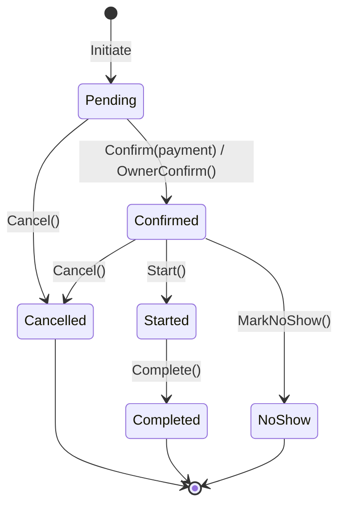

# M6 — Booking Lifecycle (As-Built)

> **Durum:** Bu spec mevcut implementasyonu belgeler (as-built, 2026-07-23) — tasarım hedefi değil, kodun ne yaptığının kaydıdır. Yeni geliştirme öncesi `docs/GAP-ANALYSIS.md` §3-4'teki P0/P1 maddelerine bakılmalı; bu dokümanda ilgili madde numaraları satır satır işaretlenmiştir.
> **Kapsam:** `backend/src/Kuaforum.Domain/Modules/Booking/`, `backend/src/Kuaforum.Application/Modules/Booking/`, ilgili background job'lar (`Kuaforum.Infrastructure/BackgroundJobs/`).
> **Bağımlılık:** M5 Availability (slot/working-hours kontrolü), M7 Payment (refund tetikleme), M4 Barber (Stylist/BarberShop/ServiceCatalog).

---

## 1. Amaç

Randevunun yaşam döngüsünü (talep → onay → hizmet → tamamlanma/iptal) tek bir aggregate (`Booking`) üzerinden state machine olarak yönetir. İptal politikasının (kademeli iade yüzdesi) ve no-show/walk-in kurallarının tek gerçek kaynağıdır — Payment modülü buradan türetilen `RefundPercentage`'ı tüketir, kendi hesap yapmaz (bkz. `07-payment.md` §4).

## 2. State Machine



Kaynak: `backend/src/Kuaforum.Domain/Modules/Booking/Booking.cs:80-190`, enum `BookingStatus` (`BookingStatus.cs:3-11`): `Pending=0, Confirmed=1, Started=2, Completed=3, Cancelled=4, NoShow=5`.

**Not:** Diyagram kodun izin verdiği geçişlerin tamamıdır — `Reschedule()` durum değiştirmez, yalnızca `ScheduledAt`/`ScheduledEndsAt` günceller (Pending veya Confirmed'da mümkün, `Booking.cs:158-174`).

## 3. Geçiş Guard'ları

| Geçiş | Guard | Kaynak |
|---|---|---|
| `Initiate` | ≥1 hizmet, `scheduledAt` geçmişte değil (-1dk tolerans), komisyon oranı %0-50 aralığında | `Booking.cs:43-48` |
| `Confirm(paymentId)` / `OwnerConfirm()` | Yalnızca `Pending`'den | `Booking.cs:82-109` |
| `Start()` | Yalnızca `Confirmed`'den | `Booking.cs:113-114` |
| `Complete()` | Yalnızca `Started`'dan | `Booking.cs:126-127` |
| `Cancel(reason)` | `Cancelled`/`Completed`/`NoShow`'dan **değil** (yani Pending, Confirmed, Started iptal edilebilir) | `Booking.cs:139-140` |
| `Reschedule(newAt)` | Yalnızca `Pending`/`Confirmed`'den, yeni zaman gelecekte olmalı | `Booking.cs:160-164` |
| `MarkNoShow()` | Yalnızca `Confirmed`'den **VE** `DateTimeOffset.UtcNow >= ScheduledEndsAt` (randevu bitiş saati geçmeden no-show işaretlenemez) | `Booking.cs:178-181` |

**Reschedule 2 saat cutoff (müşteri-özel):** `RescheduleBookingCommandHandler` — müşteri kendi randevusunu, orijinal saate 2 saatten az kalmışsa yeniden planlayamaz; işletme sahibi bu kısıtla bağlı değil. `RescheduleBookingCommand.cs:61-67`. Ayrıca komut seviyesinde `NewScheduledAt` en az 5 dakika sonrası olmalı (`RescheduleBookingCommand.cs:27-29`, validator).

**MarkNoShow zaman guard'ı — GAP-ANALYSIS P1-5'e karşı doğrulama:** GAP-ANALYSIS.md §4 P1-5 "no-show server-side zaman guard'ı yok" diyor; kod incelemesi bunun **artık geçerli olmadığını** gösteriyor — `Booking.cs:180-181` `ScheduledEndsAt` geçmeden `MarkNoShow()` `Result.Failure` döner, test `BookingTests.cs:242` (`MarkNoShow_AfterScheduledEnd_Succeeds`) + `:218` (`MarkNoShow_BeforeScheduledEnd_Fails`) bunu kilitliyor. GAP-ANALYSIS bu noktada bayat; ilgili GAP maddesi kapanmış sayılmalı (bkz. rapor bulguları).

## 4. Refund Yüzde Matrisi

`Booking.ComputeRefundPercentage(reason)` — `Booking.cs:192-204`:

| Reason | Refund % | Zaman-bağımlı mı |
|---|---|---|
| `BarberRequested` | %100 | Hayır — kuaför iptal ederse her koşulda tam iade |
| `PaymentFailed` | %100 | Hayır |
| `PendingTimeout` | %100 | Hayır (sistem tetikler; henüz job yok — bkz. §7) |
| `AdminOverride` | %100 | Hayır |
| `NoShow` | %0 | Hayır (ayrı `MarkNoShow()` yolu, `Cancel()` değil) |
| `CustomerRequested` | %100 / %50 / %0 | Evet: `ScheduledAt`'a kalan saat ≥24h → %100, 12-24h → %50, <12h → %0 |

Hesaplanan yüzde `Booking.RefundPercentage`'a yazılır ve Payment modülüne (Refund tutarının türetildiği tek kaynak) aktarılır — bkz. `07-payment.md` §4.

## 5. Cancel Reason — Server-Side Türetme (2026-07-23 Güvenlik Sprint'i)

**Önceki davranış (artık koddan kalktı):** `CancelBookingCommand` client'tan `BookingCancellationReason` alıyordu; müşteri `Reason=BarberRequested` göndererek refund matrisini bypass edip %100 iade yazdırabiliyordu (GAP-ANALYSIS P0-3).

**Mevcut davranış:** `CancelBookingCommand` artık yalnızca `(ActorUserId, BookingId)` alır — `Reason` parametresi komuttan tamamen kaldırıldı. Handler, aktörün booking ile ilişkisinden reason'ı türetir:

```csharp
// BookingActions.cs:60-66
private static async Task<BookingCancellationReason?> ResolveReasonAsync(
    DbContext ctx, BookingAggregate booking, Guid actorId, CancellationToken ct)
{
    if (booking.CustomerId == actorId) return BookingCancellationReason.CustomerRequested;
    var shop = await ctx.Set<BarberShop>().AsNoTracking().FirstOrDefaultAsync(s => s.Id == booking.BarberShopId, ct);
    return shop is not null && shop.OwnerId == actorId ? BookingCancellationReason.BarberRequested : null;
}
```

`PaymentFailed`/`PendingTimeout` yalnızca sistem tarafından, `AdminOverride` yalnızca `AdminCancelBookingCommand` (`docs/04-modules/../../backend/src/Kuaforum.Application/Modules/Admin/AdminCancelBookingCommand.cs:37`) üzerinden erişilebilir — ikisi de bu müşteri/owner-facing komuttan ulaşılamaz. Kod içi XML doc bu kararı açıkça belgeliyor (`BookingActions.cs:12-20`).

**Doğrulama testi:** `CancellationFlowTests.cs` → `Customer_cancel_ignores_client_supplied_reason_and_still_applies_less_than_12h_zero_percent` — müşterinin gönderdiği (artık kabul edilmeyen) reason'dan bağımsız olarak zaman-bazlı yüzdenin uygulandığını doğrular.

## 6. Concurrency: Redis Distributed Lock + Busy-Range Kesişimi

`InitiateBookingCommandHandler` (`InitiateBookingCommand.cs:70-81`) ve `RescheduleBookingCommandHandler` (`RescheduleBookingCommand.cs:72-90`) aynı iki adımlı korumayı kullanır:

1. **Redis lock** (`IDistributedLock.TryAcquireAsync`, SET NX + TTL 2dk, Lua script'li token-owner DEL — `RedisDistributedLock.cs:8-31`) — lock key: `slot-lock:{StylistId}:{ScheduledAt:yyyyMMddHHmm}`.
2. **Busy-range kesişim kontrolü** (`BookingBusyRangeQuery`, `Pending`/`Confirmed`/`Started` statülerini "meşgul" sayar — `BookingBusyRangeQuery.cs:14-19,29-33`).

**Bilinen sınır — lock granülaritesi (GAP-ANALYSIS P1-1):** Lock key yalnızca **başlangıç dakikasına** bağlı. 10:00-11:00 ve 10:30-11:30 farklı lock key'leri üretir, ikisi de aynı anda lock alabilir ve busy-range check'i (ayrı transaction'larda okunduğu için) aynı anda geçebilir → double-booking. DB tarafında `EXCLUDE USING gist (stylist_id WITH =, tstzrange WITH &&)` constraint'i yok; `BookingConfiguration.cs:40-48` yalnızca normal B-tree index'ler tanımlıyor (`ix_bookings_stylist_range` dahil, ama bu yalnızca sorgu hızlandırır, çakışmayı DB seviyesinde engellemez). Concurrent-request test yok. **Bu spec bu sınırı düzeltmez** — düzeltme GAP-ANALYSIS P1-1 kapsamında (`btree_gist` migration + lock'u stilist bazına indirgeme veya constraint-violation'ı 409'a map'leme).

## 7. Background Job'lar

| Job | Cron | Ne yapar | Kaynak |
|---|---|---|---|
| `AutoNoShowJob` | `*/30 * * * *` (30dk) | `Confirmed` + `ScheduledEndsAt < now-30dk` olan booking'leri `MarkNoShow()` ile otomatik işaretler (30dk grace) | `AutoNoShowJob.cs:14-60` |
| `BookingReminderJob` | `0 * * * *` (saatlik) | T-24h penceresinde (`now+23h` ile `now+25h` arası) `Confirmed` booking'lere push+in-app hatırlatma; `NotificationLog` ile idempotent (aynı booking'e iki kez gitmez) | `BookingReminderJob.cs:15-88` |
| `ExpireWalkInJob` | `*/30 * * * *` (30dk) | 2 saatten eski `WalkInAvailable=true` stilistleri otomatik `false`'a çeker | `ExpireWalkInJob.cs:13-53` |
| `ProcessBookingRefundJob` | Recurring değil — `BookingCancelledEvent` tetikler, Hangfire `Enqueue` ile tek seferlik kuyruğa girer | İptal sonrası otomatik iade — bkz. `07-payment.md` §4 | `ProcessBookingRefundJob.cs` |

Tüm cron kayıtları `DependencyInjection.RegisterRecurringJobs` içinde `IRecurringJobManager.AddOrUpdate` ile yapılır (`DependencyInjection.cs:207-232`), `TimeZoneInfo.Utc` sabit.

**PendingTimeout job'ının HENÜZ olmadığı (GAP-ANALYSIS P1-3):** `BookingCancellationReason.PendingTimeout` enum'da tanımlı (`BookingStatus.cs:18`) ve `ComputeRefundPercentage`'da %100 map'li, ama onu tetikleyecek bir background job **kodda yok**. `BackgroundJobs/` dizininde yukarıdaki 4 recurring job + `HardDeleteUsersJob` dışında iş yok. Sonuç: ödeme başlatılmadan bırakılan bir `Pending` booking süresiz kilitli kalır — `BookingBusyRangeQuery` `Pending` statüsünü de "meşgul" saydığı için (`BookingBusyRangeQuery.cs:16`), bir kullanıcı art arda `Initiate` çağırıp ödeme yapmadan stilistin takvimini doldurabilir (ücretsiz DoS). Bu spec'in yazıldığı tarihte bu job **yazılmamıştır** — GAP-ANALYSIS öneri: `ExpirePendingBookingsJob` (15dk'da bir, 30dk+ Pending → `Cancel(PendingTimeout)`).

## 8. Walk-in Akışı

`BookingType` enum'u (`BookingStatus.cs:23-27`): `Scheduled=0`, `WalkIn=1`. `InitiateBookingCommand.IsWalkIn` bayrağı `Booking.Initiate`'e `BookingType.WalkIn` olarak geçer (`InitiateBookingCommand.cs:94`). Walk-in booking'in state machine'i scheduled ile **aynıdır** — yalnızca `BookingType` alanı farklı, ayrı bir akış/aggregate yok. Müşteri tarafı keşif "şu an müsait" filtresi (`Stylist.WalkInAvailable`) M4/M9 kapsamında; süre-aşımı §7'deki `ExpireWalkInJob`. Doğrulama: `WalkInFlowTests.cs` → `Walkin_toggle_surfaces_shop_in_filter_and_booking_persists_as_walkin_type`.

## 9. Veri Modeli

### Entity: Booking (Aggregate Root)

| Alan | Tip | Not |
|---|---|---|
| Id | Guid | PK |
| CustomerId, BarberShopId, StylistId | Guid | FK, index'li (`ix_bookings_customer/stylist/shop`) |
| ScheduledAt, ScheduledEndsAt | DateTimeOffset | UTC saklanır; `ix_bookings_stylist_range` bileşik index |
| Status | enum → int | |
| BookingType | enum → int | Scheduled/WalkIn |
| TotalAmountMinor, PlatformCommissionMinor | long | kuruş cinsinden |
| CancellationReason | enum? → int | Cancel/MarkNoShow'da set edilir |
| RefundPercentage | int? | Payment modülünün tükettiği tek kaynak |
| PaymentId | Guid? | `Confirm(paymentId)` ile set edilir; `OwnerConfirm()` boş bırakır |
| Version | int | concurrency token (`Touch()` ile artar) |

Kaynak: `BookingConfiguration.cs:7-52`. Alt-entity `BookingItem` (`:54-75`) — her hizmet satırı `ServiceName`/`DurationMinutes`/`BufferMinutes`/`PriceMinor` snapshot'ı tutar (fiyat/süre sonradan değişse bile geçmiş booking etkilenmez).

### Domain Events

`BookingInitiatedEvent`, `BookingConfirmedEvent`, `BookingStartedEvent`, `BookingCompletedEvent`, `BookingCancelledEvent(Reason, RefundPercentage)`, `BookingNoShowEvent`, `BookingRescheduledEvent` — `BookingEvents.cs:5-22`. `BookingCancelledEvent` iki tüketiciye sahip: bildirim handler'ı (M11) ve `BookingCancelledRefundHandler` (M7 — bkz. `07-payment.md` §4).

## 10. API Endpoints

| Method | Path | Auth | Handler |
|---|---|---|---|
| POST | `/v1/bookings` | bearer | `InitiateBookingCommand` |
| GET | `/v1/bookings` | bearer | `GetMyBookingsQuery` (status filtresi opsiyonel) |
| GET | `/v1/bookings/{id}` | bearer | `GetBookingByIdQuery` |
| POST | `/v1/bookings/{id}/cancel` | bearer | `CancelBookingCommand` (reason server-derived, §5) |
| POST | `/v1/bookings/{id}/confirm` | bearer | `OwnerConfirmBookingCommand` |
| POST | `/v1/bookings/{id}/start` | bearer | `StartBookingCommand` |
| POST | `/v1/bookings/{id}/complete` | bearer | `CompleteBookingCommand` |
| POST | `/v1/bookings/{id}/no-show` | bearer | `MarkNoShowCommand` |
| POST | `/v1/bookings/{id}/reschedule` | bearer | `RescheduleBookingCommand` |
| GET | `/v1/owner/barber-shop/bookings` | bearer | `GetOwnerBookingsQuery` (owner-scope) |
| GET | `/v1/admin/bookings` | Admin policy | `GetAdminBookingsQuery` |
| POST | `/v1/admin/bookings/{id}/cancel` | Admin policy | `AdminCancelBookingCommand` (`AdminOverride`, %100) |

Kaynak: `BookingEndpoints.cs:14-25`, `BarberEndpoints.cs:77`, `AdminEndpoints.cs:68,106-115`. **Rol policy notu:** `/v1/bookings/*` grubu düz `RequireAuthorization()` — Customer/Owner ayrımı endpoint seviyesinde değil, handler içinde sahiplik kontrolüyle yapılıyor (`BookingActions.cs` her komutta `booking.CustomerId == actorId` veya `shop.OwnerId == actorId` kontrolü). Bu, GAP-ANALYSIS P1-4'ün (rol policy'leri tanımlı ama kullanılmıyor) booking modülündeki somut görünümü.

## 11. Bilinen Sınırlar (GAP-ANALYSIS Referansları)

| # | Sınır | GAP-ANALYSIS Maddesi |
|---|---|---|
| 1 | Double-booking: lock granülaritesi dakika-bazlı, DB EXCLUDE constraint yok, concurrent test yok | P1-1 |
| 2 | `PendingTimeout` job yok — ödenmeyen Pending booking süresiz slot kilitler | P1-3 |
| 3 | `StylistService` entity var ama `InitiateBookingCommand` yalnızca shop-service eşleşmesi kontrol ediyor (`InitiateBookingCommand.cs:58-65`) — stilist vermediği hizmete rezerve edilebilir | P1-16 (bkz. `05-availability.md` §6 için detay) |
| 4 | Rol policy'leri (`Customer`/`BarberOwner`) booking endpoint grubuna uygulanmamış, handler-seviye sahiplik kontrolüyle telafi ediliyor | P1-4 |
| 5 | `MarkNoShow` zaman guard'ı | **Kapandı** — bkz. §3, GAP-ANALYSIS'te hâlâ açık görünüyor ama kod doğrulanmış durumda kapalı |
| 6 | Cancel Reason server-side türetme | **Kapandı** (2026-07-23 sprint) — bkz. §5, GAP-ANALYSIS P0-3 |

## 12. Test Stratejisi (Mevcut Kapsam)

- **Domain (`BookingTests.cs`, 20 fact/theory):** state machine geçişleri, refund matrisi (zaman-bazlı + reason override), `MarkNoShow` zaman guard'ı.
- **Application (`BookingValidatorTests.cs`):** FluentValidation kuralları.
- **Integration (Testcontainers):**
  - `BookingFlowTests.cs` — owner tam yaşam döngüsü + in-app bildirim.
  - `CancellationFlowTests.cs` (5 test) — >24h tam iade, admin override, owner cancel, **client-supplied reason yok sayılıyor**, completed sonrası cancel reddi.
  - `AvailabilityEnforcementTests.cs` (13 test, M5 ile paylaşımlı) — reschedule 2h cutoff, `AutoNoShowJob`/`BookingReminderJob`/`ExpireWalkInJob` job testleri dahil.
  - `WalkInFlowTests.cs` — walk-in filtre + booking type persist.
  - `AutoRefundFlowTests.cs` — iptal→refund zinciri (bkz. `07-payment.md` §10).
- **Eksik:** concurrent double-booking testi (P1-1), `PendingTimeout` job'ı hiç yazılmadığı için testi de yok.

---

## Bağlantılar

- [`docs/GAP-ANALYSIS.md`](../GAP-ANALYSIS.md) §1 (M6), §3 (P0-3), §4 (P1-1, P1-3, P1-4, P1-5, P1-16)
- [`docs/04-modules/05-availability.md`](05-availability.md) — slot/working-hours kontrolü
- [`docs/04-modules/07-payment.md`](07-payment.md) — refund zinciri
- [`docs/04-modules/00-module-list.md`](00-module-list.md)
- [`docs/PHASE-0-MASTER-SPEC.md`](../PHASE-0-MASTER-SPEC.md)

**Son güncelleme:** 2026-07-23
