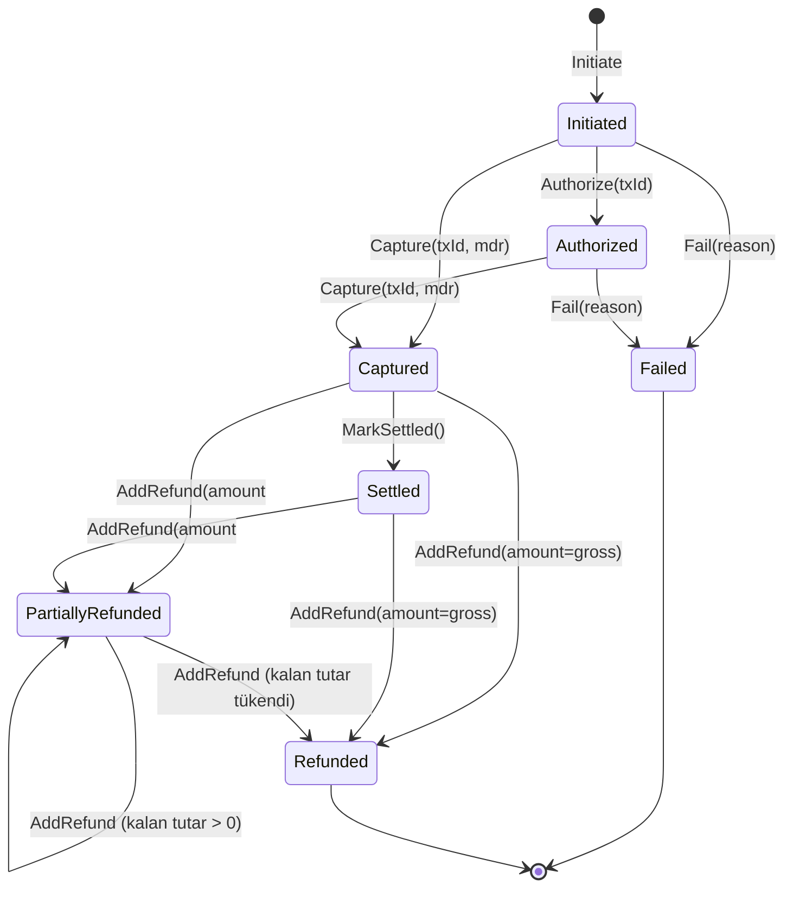
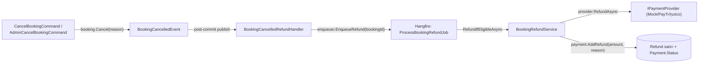

# M7 — Payment & Commission (As-Built)

> **Durum:** Bu spec mevcut implementasyonu belgeler (as-built, 2026-07-23) — tasarım hedefi değil, kodun ne yaptığının kaydıdır. Kilitli tasarım kararları için [`docs/09-payment/01-payment-architecture.md`](../09-payment/01-payment-architecture.md) (Phase 0 mimari kararı — pazaryeri modeli, PSP seçimi, e-Arşiv). Açık gap'ler için `docs/GAP-ANALYSIS.md` §3-5; bu dokümanda ilgili madde numaraları işaretli.
> **Kapsam:** `backend/src/Kuaforum.Domain/Modules/Payment/`, `backend/src/Kuaforum.Application/Modules/Payment/`, `backend/src/Kuaforum.Infrastructure/Payments/`.
> **Bağımlılık:** M6 Booking (refund yüzdesi kaynağı), M4 Barber (`SubMerchantKey`).

---

## 1. Amaç

`Payment` aggregate'i booking başına para akışını (tahsilat → komisyon ayrımı → iade) modelleyen tek gerçek kaynaktır. PSP'den bağımsız `IPaymentProvider` soyutlaması üzerinden çalışır; şu an **hiçbir gerçek PSP entegre değil** — yalnızca Mock provider dev/test akışlarını uçtan uca çalıştırıyor (bkz. §3).

## 2. Payment State Machine



Kaynak: `backend/src/Kuaforum.Domain/Modules/Payment/Payment.cs:65-149`, enum `PaymentStatus` (`PaymentStatus.cs:3-13`). `Cancelled` statüsü enum'da tanımlı (`:10`) ama kod tabanında hiçbir yerde set edilmiyor — kullanılmayan bir üye.

**Not:** Çoğu akış `Initiated → Captured` direkt geçer (`CompletePaymentCommand`, §3); `Authorize()` iki adımlı PSP'ler için hazır bırakılmış ama şu an hiçbir provider bunu çağırmıyor.

## 3. IPaymentProvider Abstraction + Registry

```csharp
// IPaymentProvider.cs:39-46
public interface IPaymentProvider
{
    PaymentProviderName ProviderName { get; }
    Task<CheckoutSession> InitiateAsync(CheckoutRequest request, CancellationToken ct = default);
    Task<PaymentVerification> VerifyAsync(string providerToken, CancellationToken ct = default);
    Task<RefundResult> RefundAsync(RefundRequest request, CancellationToken ct = default);
}
```

`PaymentProviderRegistry` (`PaymentProviderRegistry.cs:7-31`) DI container'daki tüm `IPaymentProvider` implementasyonlarını `ProviderName`'e göre indeksler; `Payment:DefaultProvider` config değerine göre (`paytr`/`iyzico`/başka her şey → `mock`) varsayılanı seçer.

| Provider | `PaymentProviderName` | Durum | Kanıt |
|---|---|---|---|
| Mock | `Mock=99` | **Gerçek, çalışıyor** — dev/test akışının tamamı bunun üzerinden geçiyor | `MockPaymentProvider.cs:11-44` — `InitiateAsync`/`VerifyAsync` her zaman başarı döner, `RefundAsync` her zaman `Succeeded:true` |
| PayTR | `PayTr=0` | **STUB** — sınıfın kendi XML doc'u "SCAFFOLDED stub" diyor | `PayTrPaymentProvider.cs:12-20` (gereksinim listesi), `:37,49,60` `logger.LogWarning(... STUB ...)`, `InitiateAsync` placeholder URL döner, `VerifyAsync` **daima `Succeeded:false`**, `RefundAsync` **daima `Succeeded:false`** |
| Iyzico | `Iyzico=1` | **STUB** — aynı kalıp | `IyzicoPaymentProvider.cs` |

`PaymentProviderName` enum: `PaymentStatus.cs:24-29`.

**Sonuç:** `Payment:DefaultProvider` config'i `paytr`/`iyzico` olarak ayarlanırsa, `InitiatePaymentCommand` gerçek bir checkout session **oluşturamaz** (placeholder URL) ve hiçbir ödeme tamamlanamaz — `VerifyAsync` her zaman false döndüğü için `CompletePaymentCommand`/webhook akışı (henüz yazılmamış, bkz. §7) hiçbir zaman booking'i confirm edemez. Production'a çıkmak için PayTR gerçek entegrasyonu şart (GAP-ANALYSIS P0-5, founder merchant hesabı bekliyor — 🟣).

## 4. Komisyon Hesabı

`InitiateBookingCommandHandler` içinde hard-coded sabit:

```csharp
// InitiateBookingCommand.cs:44
private const decimal DefaultCommissionRate = 0.10m;
```

`Booking.Initiate` bu oranı `commissionRate` parametresi olarak alır, `%0-50` aralığında doğrular (`Booking.cs:47-48`), `PlatformCommissionMinor = totalAmount * commissionRate` hesaplar (`Booking.cs:52`). `Payment.Initiate` bu tutarı booking'den kopyalar (`InitiatePaymentCommand.cs:82`), kendi hesaplama yapmaz.

`BarberShop.CommissionTier` alanı `"standard"` olarak set ediliyor (`BarberShop.cs:42`) ama **hiçbir handler bu alanı okumuyor** — tier-bazlı farklılaştırılmış komisyon (CLAUDE.md §3'te "%5-15 aralığı, kuaför tier'ına göre" olarak tasarım niyeti var) kod tarafında yok. GAP-ANALYSIS P2-1: `ICommissionPolicy` servisi + config-driven oran önerisi backlog'da.

## 5. Refund Zinciri — İptal → Otomatik İade (2026-07-23 Güvenlik Sprint'i)

### 5.1 Önceki durum (artık koddan kalktı)

GAP-ANALYSIS P0-1/P0-4'e göre eski davranış: `/v1/payments/refund` yalnızca `RequireAuthorization()` (herhangi bir login kullanıcı), `AmountMinor` client body'sinden alınıyordu (tam IDOR); iptal komutları `Booking.RefundPercentage`'ı set ediyor ama Payment aggregate'ine hiç dokunmuyordu — müşteriye "iade işleme alındı" bildirimi gidiyor ama gerçek para hareketi yoktu.

### 5.2 Mevcut zincir



- **`BookingCancelledRefundHandler`** (`BookingCancelledRefundHandler.cs:20-28`) — `BookingCancelledEvent`'in tek consumer'ı; `CancelBookingCommand` (müşteri/owner) **ve** `AdminCancelBookingCommand` aynı event'i fırlattığı için üç aktör yolu da tek handler'dan geçiyor. `MarkNoShow`'un ayrı event'i (`BookingNoShowEvent`) bilerek dinlenmiyor — no-show zaten %0 refund.
- **`ProcessBookingRefundJob`** (`ProcessBookingRefundJob.cs:24-56`) — `[AutomaticRetry(Attempts = 5)]`; PSP çağrısı asla cancel komutunun kendi transaction'ı içinde yapılmaz (cancel her zaman başarılı olur, PSP kesintisi cancel'ı geri almaz).
- **`BookingRefundService.RefundIfEligibleAsync`** (`BookingRefundService.cs:51-133`) — hem admin manuel refund endpoint'i hem otomatik job tarafından paylaşılan **tek** iade mantığı:
  1. Booking `Cancelled`/`NoShow` değilse → no-op (`BookingNotCancelled`).
  2. `RefundPercentage` 0/null ise → no-op (`NoRefundOwed`).
  3. `PaymentId` yoksa (owner-confirm/walk-in, PSP tahsilatı hiç olmamış) → no-op (`NoPayment`).
  4. Payment `Captured`/`Settled`/`PartiallyRefunded` değilse → no-op (`PaymentNotRefundable`).
  5. **Tutar `booking.RefundPercentage`'dan türetilir**, client'tan alınmaz: `owedTotalMinor = payment.GrossAmountMinor * refundPercentage / 100`; zaten yapılmış iadeler `payment.Refunds` koleksiyonundan (`Succeeded` olanlar) düşülür → idempotent (Hangfire retry / tekrar enqueue / admin manuel dokunuş güvenli no-op).
  6. PSP `RefundAsync` başarısızsa → `Result.Failure`, Hangfire retry tetiklenir.
  7. Başarılıysa `payment.AddRefund(...)` + `ctx.Set<Refund>().Add(...)` (EF Core'un `Include(p => p.Refunds)` sonrası yeni child'ı `Modified` track etme bug'ına karşı **explicit Add** — kod içi yorum `BookingRefundService.cs:109-113`, aynı kalıp review reply modülünde de var, bkz. memory `project_review_moderation_behavior`).

### 5.3 Admin manuel refund endpoint'i — artık Admin-only + tutar server-derived

```csharp
// PaymentEndpoints.cs:19-23
group.MapPost("/refund", RefundAsync)
    .WithName("RefundPayment")
    .RequireAuthorization("Admin");
```

`RefundPaymentCommand` artık yalnızca `(ActorUserId, PaymentId)` alır — `AmountMinor`/`Reason` parametreleri komuttan kaldırıldı; handler `IBookingRefundService.RefundIfEligibleAsync`'i çağırıp `booking.RefundPercentage`'dan türetilen tutarı kullanır (`RefundPaymentCommand.cs:29-54`). Bu, GAP-ANALYSIS P0-1'in tarif ettiği IDOR + tutar-manipülasyonu yüzeyini **aynı anda** kapatıyor: kim çağırabilir (Admin policy) + ne kadar iade edilir (booking'den türetilmiş, client'tan değil).

**GAP-ANALYSIS ile tutarsızlık notu:** GAP-ANALYSIS.md §3 P0-1 ve P0-4'ü "açık" (launch blocker) olarak listeliyor; kod incelemesi bu ikisinin **kapanmış** olduğunu gösteriyor (P0-2 mock/complete env-gate de dahil, bkz. §6). Bu spec'in tarihi ile GAP-ANALYSIS'in tarihi aynı gün (2026-07-23) — güvenlik sprint'i GAP-ANALYSIS'in kodu taradığı andan sonra, muhtemelen aynı gün içinde tamamlanmış. GAP-ANALYSIS'in bu üç maddesi bir sonraki revizyonda kapalı olarak işaretlenmeli.

## 6. mock/complete Endpoint'i — Yalnızca Development

```csharp
// PaymentEndpoints.cs:25-33
if (env.IsDevelopment())
{
    group.MapGet("/mock/complete", MockCompleteAsync)
        .WithName("MockCompletePayment")
        .AllowAnonymous();
}
```

Dev-login kalıbının aynısı: endpoint yalnızca `IWebHostEnvironment.IsDevelopment()` true iken map ediliyor, prod build'de route hiç yok. Handler tarafında ikinci savunma katmanı: `CompletePaymentCommandHandler` payment'ın `Provider == Mock` **ve** komutun `Provider == Mock` olduğunu doğruluyor (`CompletePaymentCommand.cs:52-53`) — tahmin edilebilir token formatı (`mock-{paymentId:N}`, `CompletePaymentCommand.cs:84-88`) bir gerçek-PSP ödemesine karşı replay edilemez. GAP-ANALYSIS P0-2'nin tarif ettiği "AllowAnonymous env-gate'siz" durumu bu spec'in yazıldığı kod durumunda **kapalı**; aynı tutarsızlık notu §5.3'teki gibi geçerli.

## 7. Henüz Olmayan: Webhook / 3DS Callback

`Endpoints/` dizininde `/webhooks` altında hiçbir route yok (grep 0 sonuç, GAP-ANALYSIS P0-5 ile teyitli). `PayTrPaymentProvider.VerifyAsync` gerçek bir webhook payload'ı doğrulamaz — daima `Succeeded:false` döner (§3). Bu, mevcut mimaride ödeme tamamlamanın **tek yolunun** dev-only mock endpoint olduğu anlamına gelir; gerçek PSP ile canlıya çıkmak için önce `POST /v1/webhooks/paytr` (HMAC doğrulama + idempotent completion) yazılmalı — GAP-ANALYSIS §9 Cycle 9 plan madde 6.

## 8. e-Arşiv (Nilvera) — Sıfır Kod

`PaymentSettledEvent` raise ediliyor (`Payment.cs:92`, `PaymentEvents.cs`) ama onu dinleyip fatura kesecek bir consumer yok. `grep 'Nilvera|Invoice|Fatura'` backend'de 0 sonuç veriyor (GAP-ANALYSIS P0-13). CLAUDE.md §3 stack tablosu çift fatura akışını (kuaför→müşteri %20 KDV + platform→kuaför komisyon %20 KDV) Day-1 kararı sayıyor, ama bu katman **hiç implement edilmemiş**. Founder Nilvera hesabı + mali müşavir teyidi bekliyor (🟣); gerçek tahsilat başlamadan launch'ı bloklamaz (mock ödemeyle çıkılıyorsa), ama gerçek para akışı açılır açılmaz vergi denetimi riski.

## 9. Idempotency

`InitiatePaymentCommand` `IdempotencyKey` (opsiyonel, client `Idempotency-Key` header'ından — `PaymentEndpoints.cs:46`) alır. Uygulama seviyesinde kontrol (`InitiatePaymentCommand.cs:43-49`) + DB seviyesinde unique index (`ux_payments_idempotency`, `HasFilter("idempotency_key IS NOT NULL")` — `PaymentConfiguration.cs:45`) çift katman: concurrent istekler app-check'i geçse bile `SaveChangesAsync` unique-violation (`SQLSTATE 23505`) fırlatır, handler bunu Npgsql'e sert bağımlılık olmadan reflection ile yakalayıp `409 Conflict`'e çevirir (`InitiatePaymentCommand.cs:128-143`). Ayrıca booking başına tek payment garantisi: `ux_payments_booking` unique index (`PaymentConfiguration.cs:39`).

Refund tarafında idempotency ayrı bir mekanizma değil — §5.2'deki "kalan tutarı `Payment.Refunds`'tan yeniden türet" tasarımı doğası gereği idempotent (bkz. `BookingRefundService.cs:35-45` XML doc).

## 10. Veri Modeli

### Entity: Payment (Aggregate Root)

| Alan | Tip | Not |
|---|---|---|
| Id | Guid | PK |
| BookingId | Guid | `ux_payments_booking` unique |
| SubMerchantBarberShopId | Guid | Pazaryeri modeli sub-merchant referansı |
| Provider | enum → int | Mock/PayTr/Iyzico |
| Status | enum → int | §2 state machine |
| GrossAmountMinor, PlatformCommissionMinor, PspMdrMinor, NetToBarberMinor | long | kuruş; `NetToBarberMinor = Gross - Commission - Mdr`, yalnızca `Capture()`'da hesaplanır |
| IdempotencyKey | string? | `ux_payments_idempotency` unique (nullable-filtered) |
| ProviderTransactionId | string? | PSP tx id |

Kaynak: `PaymentConfiguration.cs:7-49`. Alt-entity `Refund` (`:51-72`) — `AmountMinor`, `Reason` (enum `RefundReason`: `CustomerRequested/BarberRequested/NoShowRefund/AdminOverride/PaymentFailed` — `PaymentStatus.cs:15-22`), `Status` (`Pending/Succeeded/Failed`, Mock provider her zaman `Succeeded` yazar — `Payment.cs:170`, gerçek PSP `Pending` ile başlayabilir ama bunu tüketen bir reconciliation job yok).

### Domain Events

`PaymentInitiatedEvent`, `PaymentAuthorizedEvent`, `PaymentCapturedEvent`, `PaymentSettledEvent`, `PaymentFailedEvent`, `PaymentRefundedEvent` — `Payment.cs` içinde raise ediliyor.

## 11. API Endpoints

| Method | Path | Auth | Handler |
|---|---|---|---|
| POST | `/v1/payments/initiate` | bearer | `InitiatePaymentCommand` |
| POST | `/v1/payments/refund` | **Admin policy** | `RefundPaymentCommand` (§5.3) |
| GET | `/v1/payments/mock/complete` | **yalnızca Development**, anonim | `CompletePaymentCommand` (§6) |

Kaynak: `PaymentEndpoints.cs:11-36`.

## 12. Bilinen Sınırlar (GAP-ANALYSIS Referansları)

| # | Sınır | GAP-ANALYSIS Maddesi | Durum |
|---|---|---|---|
| 1 | Refund IDOR + tutar client-controlled | P0-1 | **Kapandı** (§5.3) |
| 2 | mock/complete env-gate'siz | P0-2 | **Kapandı** (§6) |
| 3 | İptal→iade otomasyonu yok | P0-4 | **Kapandı** (§5.2) |
| 4 | PayTR/Iyzico stub + webhook yok | P0-5 | **Açık** — founder merchant hesabı bekliyor (🟣) |
| 5 | e-Arşiv (Nilvera) sıfır kod | P0-13 | **Açık** — founder hesap + mali müşavir bekliyor (🟣) |
| 6 | Komisyon oranı hard-coded, `CommissionTier` ölü alan | P2-1 | **Açık** |
| 7 | Mobile ödeme UI hiç bağlanmamış (`mobile/app/booking/confirm.tsx`) | P0-5 kapsamında | **Açık** — bu spec backend'i kapsar, mobile UI ayrı iş |

## 13. Test Stratejisi (Mevcut Kapsam)

- **Domain (`PaymentTests.cs`, 20 fact/theory):** state machine geçişleri, kısmi iade birikimi + aşım koruması (`AddRefund` toplam `GrossAmountMinor`'ı aşamaz).
- **Integration (Testcontainers):**
  - `PaymentInitiationTests.cs` — checkout session + idempotency replay engelleme, sahiplik olmayan müşteri reddi.
  - `RefundFlowTests.cs` (4 test) — non-admin refund reddi, tutarın `RefundPercentage`'dan türediği, iptal edilmemiş booking'de refund reddi, mock-olmayan provider'a mock/complete reddi.
  - `AutoRefundFlowTests.cs` (6 test) — >24h müşteri iptali → job üzerinden tam otomatik iade, admin iptal → otomatik iade, hiç tamamlanmamış ödemede no-op, <12h iptalde sıfır iade, job iki kez çalışınca çift iade olmaması, PSP hatasında iade atılmayıp job'ın exception fırlatması (Hangfire retry sinyali).
- **Eksik:** gerçek PSP entegrasyon testi (stub olduğu için anlamsız), webhook idempotency testi (webhook henüz yok), e-Arşiv testi (modül yok).

---

## 14. RFC-006 İmplementasyonu (2026-07-30, as-built)

> [RFC-006 kapora + checkout](../rfc/RFC-006-kapora-checkout.md) implementasyonunun kaydı. §7'nin "webhook yok" tespiti ve §12 tablosundaki 4/7 numaralı satırların webhook + mobile-UI kısımları bu bölümle **güncellenmiştir** — kalan tek açık iş gerçek PayTR credentials + canlıya alma checklist'i (🟣 founder-bloklu, bkz. GAP-ANALYSIS P0-5 güncellemesi).

### 14.1 PaymentKind + kapora hesabı

- `PaymentKind` enum'u `FullOnline=0 | Deposit=1` — `Kuaforum.Domain/Modules/Payment/PaymentKind.cs:4-8`; `Payment.Kind` kolonu M16 migration ile (`Persistence/Migrations/20260730052747_M16_PaymentKind.cs`).
- Oranlar config-driven: `PaymentOptions` → `Payment:CommissionRate=0.10` + `Payment:DepositRate=0.15` (`Kuaforum.Application/Common/PaymentOptions.cs:9-18`). Startup invariant'ı: `DepositRate >= CommissionRate` + aralık kontrolleri, `ValidateOnStart()` ile boot'ta fail-fast (`Infrastructure/DependencyInjection.cs:63-69`).
- Tutar matematiği tek kaynak: `PaymentAmounts.CalculateDepositMinor = ceil(total × rate)`, `CalculateCommissionMinor = round` (`Kuaforum.Domain/Common/PaymentAmounts.cs:14-18`). **Ceil + invariant birlikte kapora ≥ komisyon garantisini küçük tutarlarda da korur**; domain guard'ı ayrıca `Payment.cs:47` (komisyon > gross reddi).

### 14.2 InitiatePayment: `kind` parametresi + ReinitiateCheckout (resume/switch)

- `InitiatePaymentCommand(CustomerId, BookingId, Kind, IdempotencyKey)`; response artık `AmountMinor` (online tahsil edilen) + `RemainingAtShopMinor` + `Kind` taşır (`InitiatePaymentCommand.cs:15-32`).
- Booking başına tek payment satırı korunur (`ux_payments_booking`): para hareketi başlamışsa (Captured+) → 409; `Initiated/Authorized/Failed`'da mevcut satır `Payment.ReinitiateCheckout(kind, gross, commission)` ile yeniden kullanılır — müşteri Deposit ⇄ FullOnline geçebilir veya başarısız ödemeyi yeniden dener (`InitiatePaymentCommand.cs:69-106`; domain geçiş guard'ı `Payment.cs:138-149`). Eşzamanlı reinitiate yarışı `Version` concurrency token'ıyla yakalanıp 409'a çevrilir (`InitiatePaymentCommand.cs:149-154`).

### 14.3 PayTR webhook iskeleti

- `POST /v1/webhooks/paytr` — AllowAnonymous + HMAC (`Api/Endpoints/WebhookEndpoints.cs:15-66`). Şema PayTR resmi doc ile doğrulandı (2026-07-30): form-urlencoded `merchant_oid` + `status` + `total_amount` + `hash`; yanıt gövdesi literal `"OK"` olmalı, aksi halde PayTR bildirimi tekrar eder.
- **Fail-closed guard:** `MerchantKey`/`MerchantSalt` yapılandırılmamışsa imza doğrulamasına hiç girilmez → 503 (`WebhookEndpoints.cs:36-40`) — boş key ile HMAC deterministik hesaplanabilir olurdu (ödemesiz confirm forge riski).
- İmza karşılaştırması `CryptographicOperations.FixedTimeEquals` (`WebhookEndpoints.cs:50-51`); hesap `PaytrWebhookSignature.Compute` (`Infrastructure/Payments/PaytrWebhookSignature.cs:13-17`).
- İş mantığı `ProcessPaytrWebhookCommand` (`Application/Modules/Payment/ProcessPaytrWebhookCommand.cs`): **idempotency** — Captured/Settled/(Partially)Refunded satıra gelen retry hiçbir şey yazmadan OK'lenir (`:47-51`); **tutar-mismatch koruması** — ReinitiateCheckout sonrası stale checkout session'ının eski tutarlı callback'i capture edilmez, `payment.webhook_amount_mismatch` audit satırı yazılır (`:53-72`); success → `PaymentCompletionService.CaptureAndConfirmAsync` (`PaymentCompletionService.cs:16`), failed → `payment.Fail` (`:74-86`). Bilinmeyen `merchant_oid` dahil her durumda 200 "OK" — PayTR retry fırtınası önlenir.

### 14.4 Mobile akış

- **Seçim kartı** — `mobile/app/booking/confirm.tsx:155-178`: radiogroup, kapora varsayılan seçili, "Şimdi X TL · Salonda Y TL" / "Tamamını şimdi öde: Z TL". Ön izleme helper'ları `mobile/src/lib/deposit.ts` (`DEPOSIT_RATE` backend `Payment:DepositRate` ile elle senkron — kesin tutar initiate response'undan).
- **Checkout ekranı** — `mobile/app/booking/payment.tsx`: fazlar `checkout → verifying → success | cancelled | pendingWebhook | error`; mock provider'da yerel simülasyon (`toRelativePath` origin-soyma + token sızıntısı koruması, `:46-53`), gerçek modda `CheckoutWebView` (originWhitelist'li); `verifying` 2sn aralıkla max 8 poll; success'te `['booking', id]` + `['my-bookings']` TanStack cache invalidation (60sn staleTime'lı bayat CTA fix'i).
- **Detay + rozet** — `mobile/app/booking/[id].tsx`: "Salonda ödenecek" satırı, "Ödemeyi tamamla" CTA (yalnız müşteri + Pending + payment yok), Alert seçeneklerinde hesaplanmış tutarlar; owner Bugün ekranı `mobile/app/(barber)/today.tsx:262-268` "Salonda: X TL" rozeti.
- **API katmanı** — `mobile/src/api/payment.ts`: `PaymentApi.initiate(bookingId, kind)` + idempotency-key header.

### 14.5 DTO alanları

Booking detay/liste DTO'ları `PaymentKind? PaymentKind` + `long? PaidOnlineMinor` + `long RemainingAtShopMinor` döner (`GetBookingQueries.cs:35-37`). Türetme tek yerden: `BookingPaymentProjection.Resolve` (`GetBookingQueries.cs:44-60`) — yalnız fiilen ödenmiş (`PaidStatuses`: Captured/Settled/PartiallyRefunded/Refunded) payment sayılır, kalan tutar yalnız `Deposit`'te > 0.

### 14.6 Test kapsamı (RFC-006 eklentisi)

`DepositPaymentTests` (kapora tutarı/ceil + invariant + resume/switch), `PaytrWebhookTests` (HMAC + idempotency + tutar-mismatch + fail-closed), tam ödeme regresyonu mevcut suite'te; mobile `deposit.test.ts` helper jest'leri. Suite toplamı: 123 domain + 63 application + 76 integration + 53 mobile jest (2026-07-30, tamamı yeşil).

---

## Bağlantılar

- [`docs/GAP-ANALYSIS.md`](../GAP-ANALYSIS.md) §1 (M7), §3 (P0-1, P0-2, P0-4, P0-5, P0-13), §5 (P2-1)
- [`docs/09-payment/01-payment-architecture.md`](../09-payment/01-payment-architecture.md) — Phase 0 tasarım kararı (pazaryeri modeli, PSP seçimi)
- [`docs/01-research/payment-infrastructure.md`](../01-research/payment-infrastructure.md) — regülasyon analizi
- [`docs/04-modules/06-booking.md`](06-booking.md) — refund yüzdesi kaynağı
- [`docs/04-modules/00-module-list.md`](00-module-list.md)
- [`docs/PHASE-0-MASTER-SPEC.md`](../PHASE-0-MASTER-SPEC.md)

**Son güncelleme:** 2026-07-30 (RFC-006 as-built bölümü — §14)
