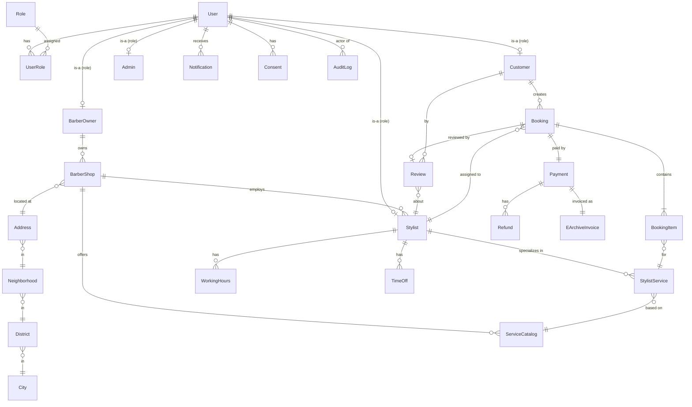

# Veri Modeli — Üst Seviye Görünüm (ER Overview)

> Bu doküman **modül seviyesindeki** entity'lere atıf yapar. Her modülün kendi spec'i içinde detaylı entity tasarımı bulunur. Bu dokümanın amacı **cross-module ilişki haritası**.

---

## 1. Üst Seviye ER (Mermaid)



> **Not:** Bu sadece üst seviye. Her modülün spec'inde kendi field listesi, index stratejisi, constraint'leri olacak.

---

## 2. Aggregate Root Listesi

| Aggregate | Modül | Açıklama |
|---|---|---|
| `User` | M2 User | Kimlik kaynağı. Roller user'a bağlı. |
| `BarberShop` | M4 Barber | İşletme. `Stylist`'leri kapsar (composition). |
| `Stylist` | M4 Barber | Bireysel kuaför/berber. |
| `ServiceCatalog` | M4 Barber | Hizmet tanımları. |
| `WorkingHours` | M5 Availability | Stilist haftalık takvim. |
| `Booking` | M6 Booking | Randevu state machine. |
| `Payment` | M7 Payment | Ödeme aggregate. |
| `Refund` | M7 Payment | İade işlemi (Payment'a bağlı). |
| `EArchiveInvoice` | M7 Payment | Çift fatura kayıtları. |
| `Review` | M8 Review | Yorum + puan. |
| `Notification` | M11 Notification | Kullanıcıya gönderilen bildirim. |
| `Consent` | M2 User | KVKK rıza kayıtları. |
| `AuditLog` | M1+M2 Audit | Append-only audit. |

---

## 3. Cross-Module Bağlantılar

| Bağlantı | Yönlü | Tipi |
|---|---|---|
| Booking → Stylist | M6 → M4 | FK ID-only (modül sınırı) |
| Booking → Customer | M6 → M2 | FK ID-only |
| Payment → Booking | M7 → M6 | FK ID-only |
| Review → Booking | M8 → M6 | FK ID-only |
| Notification → User | M11 → M2 | FK ID-only |
| EArchiveInvoice → Payment | M7 → M7 | FK direkt (intra-module) |

**Disiplin:** Cross-module entity'ler ID-only referans. Joined query istenirse modül public Contracts üzerinden DTO ile.

---

## 4. Lokasyon (Geographic) Yapısı

```
City (81)
  └── District (~970)
        └── Neighborhood (~30K+)
              └── BarberShop  ← lat/long ekstra (PostGIS GEOMETRY POINT)
```

- **Veri kaynağı:** NVI açık veri seti.
- **Bootstrap script:** Phase 1 M3 sırasında.
- **Manuel düzeltme:** Admin paneli.
- **PostGIS index:** `BarberShop.location` GIST index, K-NN sorgu için.

---

## 5. Kritik Tabloların Tahmini Büyüklük (Year 1)

| Tablo | Satır (Y1) | Notes |
|---|---|---|
| `users` | 100K-300K | Customer + Stylist + Admin |
| `barber_shops` | 1K-5K | İşletme |
| `stylists` | 3K-15K | İşletme başına 1-5 |
| `service_catalogs` | 10K-50K | Stylist başına 5-10 |
| `bookings` | 300K-3M | Year 1 hedefe göre |
| `payments` | 300K-3M | Booking 1:1 |
| `refunds` | 30K-300K | %10 oranında |
| `reviews` | 100K-1M | Booking'in ~%30'u |
| `notifications` | 5M-50M | Push + SMS + email |
| `audit_logs` | 1M-10M | Kritik aksiyon |

> Hot tablolar (notifications, audit_logs) için Phase 3'te **partition strategy** (monthly).

---

## 6. KVKK Veri Sınıflandırması

| Veri Kategorisi | Örnek | KVKK Sınıf | Saklama |
|---|---|---|---|
| **Kimlik** | Ad, soyad, telefon, e-posta | Genel m.5 | Hesap aktif olduğu sürece + 30 gün silme süresi |
| **İletişim** | Telefon, e-posta | Genel m.5 | Aynı |
| **Konum** | GPS koordinat, mahalle | Genel m.5 (hassas değil) | Randevu sonrası 90 gün |
| **Sağlık** | Alerji notu, saç-cilt durumu | **Hassas m.6** | Ayrı consent + ayrı erişim |
| **Finansal** | IBAN (kuaför), ödeme detay | Genel m.5 | Yasal saklama 10 yıl (vergi) |
| **Davranışsal** | Arama, tıklama | Genel m.5 | 12 ay agregat sonrası anonim |

Detay: [`docs/08-security/02-kvkk-overview.md`](../08-security/02-kvkk-overview.md).

---

## 7. Modül Spec Atıfları

Her modül kendi entity şemasını + indeks stratejisini + edge case'lerini şu doc'larda detaylar (Phase 1+ yazılır):
- `docs/04-modules/01-auth.md`
- `docs/04-modules/02-user.md`
- `docs/04-modules/03-geography.md`
- `docs/04-modules/04-barber.md`
- `docs/04-modules/05-availability.md`
- `docs/04-modules/06-booking.md`
- `docs/04-modules/07-payment.md`
- ... vs.

---

## Bağlantılar

- [`docs/PHASE-0-MASTER-SPEC.md`](../PHASE-0-MASTER-SPEC.md)
- [`docs/04-modules/00-module-list.md`](../04-modules/00-module-list.md)
