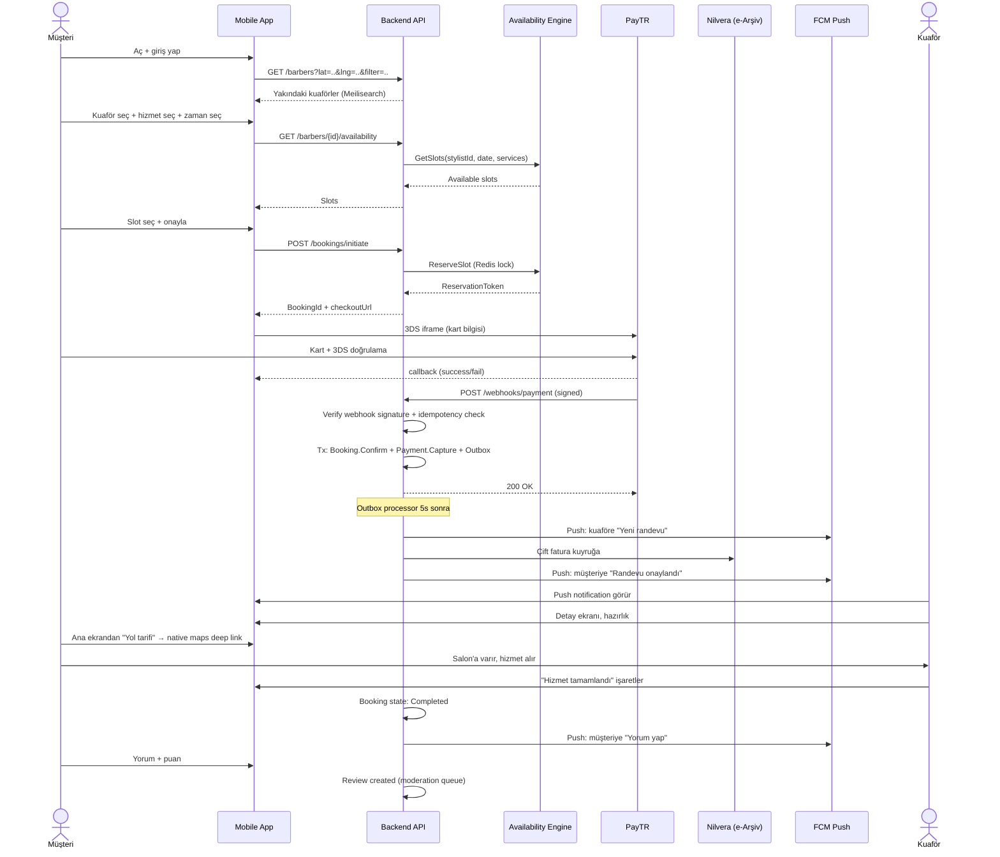
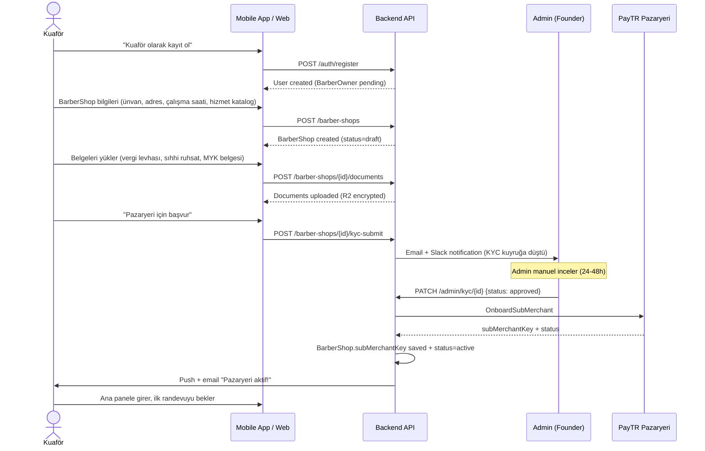
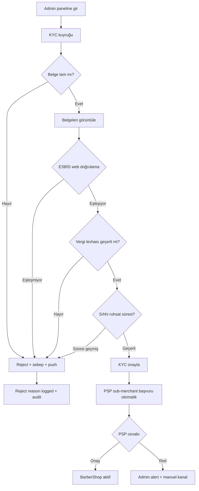
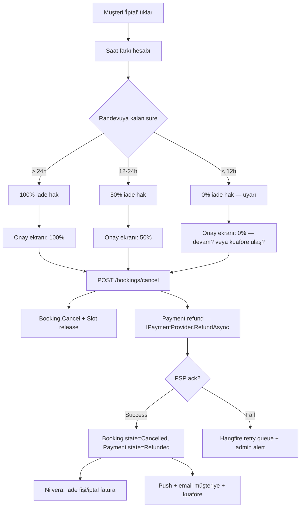

# Kullanıcı Akışları (User Journeys)

> 3 ana akış: Müşteri Booking, Kuaför Onboarding, Admin KYC. Detaylı state machine'ler modül spec'lerinde.

---

## 1. Müşteri Booking Akışı (Happy Path)



**Edge case'ler:**
- Slot rezervasyon çakışması (concurrent) → Redis lock retry, başarısızsa "slot kapandı".
- 3DS başarısız → Booking state Pending kalır, 15 dk sonra Availability slot release.
- Webhook gelmezse → 2 dakika sonra polling fallback.
- Kuaför reddederse → Auto refund (kademeli — randevuya 24h+ ise %100).
- Müşteri iptal → Kademeli refund.

---

## 2. Kuaför Onboarding Akışı



**Edge case'ler:**
- Belge eksikse: admin reddeder, kuaföre "şu belgeyi tekrar yükle" mesajı.
- PSP red → admin alert, manuel kanal denenir (Iyzico fallback).
- Belge OCR yanlış okuma (V1.5'tan itibaren OCR yardımcısı): manuel düzeltme.

---

## 3. Admin KYC İnceleme Akışı



---

## 4. İptal & İade Akışı



---

## 5. Walk-in (Simplified) Akışı

```mermaid
sequenceDiagram
    actor K as Kuaför
    actor M as Müşteri
    participant App as Mobile App
    participant API as Backend API

    K->>App: Panelde "Şu an boşum" toggle ON
    App->>API: PATCH /stylists/{id}/walk-in {available: true}
    API->>API: Stylist.walkInAvailable = true (TTL: 60dk auto-off)
    
    M->>App: Keşif ekranında "Açık + Boş" filtresi
    App->>API: GET /barbers?openNow=true&walkInOnly=true
    API-->>App: Yakın + boş kuaförler
    M->>App: Bir kuaför seç + "Hemen yürüyorum"
    App->>API: POST /bookings/initiate (walkIn=true, services=[..])
    API->>API: Booking pending + slot 30dk sonrası rezerve
    Note over M: Müşteri yürür / araçla gider
    M->>K: Salonda görünür
    K->>App: "Müşteri geldi, başlıyorum"
    App->>API: PATCH /bookings/{id}/start
    API->>API: Booking.Start + Stylist.walkInAvailable = false (otomatik)
    K->>K: Hizmet
    K->>App: "Tamamlandı" + ödeme
    [Sonra normal Booking + Payment + Review akışı]
```

**Edge case'ler:**
- 60 dakika walk-in toggle açık kaldıysa otomatik OFF.
- Walk-in slot rezervasyonu 30 dakika içinde müşteri gelmezse → release.
- Kuaför "müşteri geldi" işaretlerse otomatik off (ilk gelen ilk hizmet).

---

## 6. Eksik Akışlar (Modül Spec'lerinde detaylanır)

- **OAuth login (Apple/Google)** — M1 spec.
- **Telefon değişikliği akışı** — M1 spec.
- **KVKK silme talebi** — M2 spec.
- **Yorum moderasyon** — M8 spec.
- **Promo kod kullanımı** (V1.5) — M14 spec.
- **Multi-stylist randevu** (aynı booking'de birden fazla stilist) — M5+M6 spec.

---

## Bağlantılar

- [`docs/PHASE-0-MASTER-SPEC.md`](../PHASE-0-MASTER-SPEC.md)
- [`docs/04-modules/00-module-list.md`](../04-modules/00-module-list.md)
- [`docs/09-payment/01-payment-architecture.md`](../09-payment/01-payment-architecture.md)
