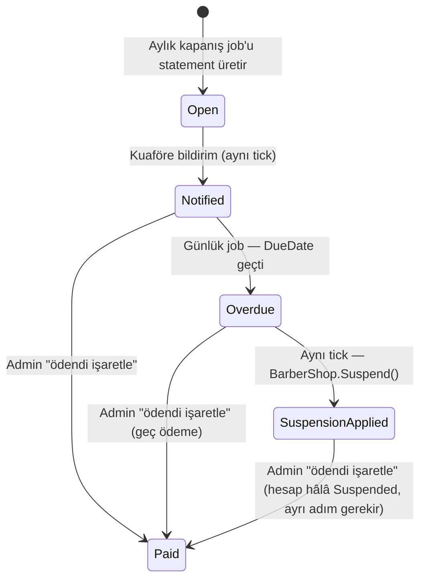

# Komisyon Modeli — Detay

> ## ⛔ BU DOKÜMAN ARTIK GEÇERLİ DEĞİL — 2026-08-07
>
> **Komisyon modeli tamamen kaldırıldı.** Founder kararıyla ([RFC-014](../rfc/RFC-014-abonelik-modeli-ve-domain-duzeltmeleri.md), 2026-08-06) gelir modeli **ciro komisyonundan sabit aylık aboneliğe** geçti. Platform artık ciro üzerinden hiçbir pay almıyor.
>
> **Güncel model için tek kaynak:** [`RFC-014`](../rfc/RFC-014-abonelik-modeli-ve-domain-duzeltmeleri.md). Para/faturalama işine girmeden önce onu oku.
>
> Bu doküman **tarihsel kayıt** olarak duruyor: neden önce randevu-başına komisyon, sonra aylık ciro komisyonu, sonra abonelik denendiğinin izi burada. **As-built referansı olarak KULLANMA** — aşağıda anlatılan şu API'ler ve alanlar kodda artık YOK (commit `e6d5a6e` ile silindi):
>
> | Doküman ne diyor | Gerçek |
> |---|---|
> | `CommissionStatement` aggregate | `SubscriptionInvoice` olarak yeniden adlandırıldı |
> | `CommissionPayment` | `SubscriptionInvoicePayment` |
> | `BarberShop.CommissionRateOverride`, `SetCommissionRateOverride` | Silindi |
> | `PUT /v1/admin/billing/barber-shops/{id}/commission-rate` | Endpoint silindi (404) |
> | `commissionRateGlobal` (admin ayarları) | Silindi |
> | `basisAmountMinor`, `rateApplied` (fatura DTO) | `planCode`, `planPriceMinor` |
> | Komisyon matrahı = ay içi Completed ciro × oran | Fatura tutarı = planın `PriceMinor` değeri |
>
> Değişmeyen tek şey faturalama **omurgası**: fatura → 7 gün vade → hatırlatma → askı → itiraz → ödeme. Yalnız tutarın kaynağı değişti.

> Detaylı ödeme mimarisi: [`01-payment-architecture.md`](01-payment-architecture.md). Bu doküman komisyon hesaplama + tahsilat + örnek senaryolar.

---

## Güncelleme 2026-08-05 (RFC-012/013) — kendisi de RFC-014 ile süpersedelendi, aşağısı tarihsel

**Bu dokümanın önceki hâli hatalıydı:** "randevu başına anlık komisyon, ödeme anında kesilir" modelini anlatıyordu. Founder kararıyla ([RFC-012](../rfc/RFC-012-monthly-commission-billing.md), 2026-08-05) bu model **süpersedelendi**. Güncel gerçek:

- Kuaför kaydı **ücretsiz**, randevu başına kesinti **yok**.
- Komisyon **aylık ciro üzerinden** tahakkuk eder: o ay `Completed` olan randevuların toplamı × oran (admin-ayarlı global %20 default + kuaföre özel override).
- Ay sonunda `CommissionStatement` oluşur, **7 gün vade**; ödenmezse hesap **otomatik pasife** düşer.
- Tahsilat **havale/EFT + admin onayı** (MVP'den itibaren); **PayTR online ödeme iskeleti** hazır, merchant hesabı bağlanınca aktifleşir.
- [RFC-006](../rfc/RFC-006-kapora-checkout.md) çapraz notu: **kapora artık komisyon taşımıyor**, tamamen kuaföre akıyor.
- [RFC-009](../rfc/RFC-009-free-growth-mode.md): online ödeme launch'ta feature-flag ile **kapalı** (`Payment:OnlinePaymentsEnabled=false`) — checkout/split senaryoları şu an teorik, flag açılınca geçerli olacak.
- [RFC-013](../rfc/RFC-013-per-shop-deposit-and-booking-rules.md): kapora artık per-shop ayar (aç/kapa + yüzde), her randevuda kuaför onayı zorunlu — bu doc'un komisyon matrahını etkilemiyor ama checkout akışının önkoşulu.

Aşağıdaki §1, §3, §5, §6 bu güncel modele göre yeniden yazıldı. Eski model tam olarak **§10'da tarihsel kayıt olarak** tutuluyor — neden silmek yerine arşivlediğimizin gerekçesi orada.

---

## 1. Güncel Komisyon Modeli — Aylık Ciro Faturalama (RFC-012)

- **Abonelik / kayıt ücreti yok.** Kuaför platforma ücretsiz kaydolur.
- **Matrah:** yalnız o ay `Status = Completed` olan randevuların `TotalAmountMinor` toplamı. İptal, no-show, Pending/Cancelled randevular matraha girmez. Walk-in randevular **dahildir** — hariç tutulsaydı "walk-in" işaretleyip komisyondan kaçma kapısı açılırdı ([RFC-012](../rfc/RFC-012-monthly-commission-billing.md) §"Matrah kapsamı").
- **Oran:** `PlatformSettings.CommissionRateGlobal` (DB-backed, admin self-servis değiştirir — `appsettings`/`IOptions` değil, restart gerekmiyor). Kuaföre özel override: `BarberShop.CommissionRateOverride` (`decimal?`, null = global oranı miras alır).
  - Kod: `PlatformSettings.CreateDefault(decimal commissionRateGlobal = 0.20m)` — seeder'ın koyduğu örnek değer, **founder'ın kesin ilk rakamı henüz onaylamadığı** placeholder (`backend/src/Kuaforum.Domain/Modules/Billing/PlatformSettings.cs:17,27-33`). Admin `PUT /v1/admin/billing/settings` ile değiştirir (`backend/src/Kuaforum.Api/Endpoints/BillingEndpoints.cs:82`).
  - Kod: `BarberShop.CommissionRateOverride` + `SetCommissionRateOverride(decimal? rate)` (`backend/src/Kuaforum.Domain/Modules/Barber/BarberShop.cs:35,136`), admin `PUT /v1/admin/billing/barber-shops/{id}/commission-rate` ile set edilir (`BillingEndpoints.cs:92`).
- **Hesaplama tek kaynak:** `PaymentAmounts.CalculateCommissionMinor(basisAmountMinor, rateApplied)` — yeni bir yuvarlama mantığı icat edilmedi, `Booking.Initiate`'in de kullandığı aynı helper (`backend/src/Kuaforum.Domain/Common/PaymentAmounts.cs:17`, çağrı: `CommissionStatement.cs:65`).
- **Snapshot ilkesi:** `RateApplied` kapanış anında sabitlenir — sonraki oran değişiklikleri geçmiş statement'ı etkilemez (RFC-006'nın `DepositRate` snapshot presedentiyle aynı ilke; `CommissionStatement.cs:19-20,34`).

### State machine (`CommissionStatement`)



Kod: enum + geçiş metodları `backend/src/Kuaforum.Domain/Modules/Billing/CommissionStatement.cs:6-13,72-181`. `Paid`'e geçiş hesabı **otomatik aktifleştirmez** — admin `ReactivateBarberShopCommand`'ı ayrı bir adımda çağırır (madde 4, RFC-012).

### Vade ve yaptırım

| Alan | Değer | Kod referansı |
|---|---|---|
| `DueDate` | `PeriodEnd + 7 gün` (job'un çalışma anına değil, dönem sonuna bağlı) | `CommissionStatement.cs:41,66` |
| Vade job'u | Günlük 03:00 UTC, cron `"0 3 * * *"` | `SuspendOverdueCommissionAccountsJob.cs:39` |
| Overdue tespiti | `Status == Notified && DueDate < today` → `MarkOverdue()` | `SuspendOverdueCommissionAccountsJob.cs:52-53,71` |
| Askı | `shop.Suspend($"commission_overdue:{statement.Id}")` + `statement.ApplySuspension()` | `SuspendOverdueCommissionAccountsJob.cs:91,99` |
| Audit | `actorUserId: null` (sistem tetikli — `AutoNoShowJob` presedenti) | `SuspendOverdueCommissionAccountsJob.cs:102-108` |
| Vade hatırlatması | Aynı job, `DueDate == bugün+2` → in-app + push bildirim | `SuspendOverdueCommissionAccountsJob.cs:118-159` |

**Tüm düzeltme yetkisi adminde:** oran değiştirme, tutar düzeltme (`AdjustAmount`), vade uzatma (`ExtendDueDate`), manuel ödendi işaretleme (`MarkPaid`) — hepsi `CommissionStatement.cs:112-181`'de, ilgili endpoint'ler `BillingEndpoints.cs:109-125` (`mark-paid`, `adjust`, `extend-due`).

### Tahsilat — çift kanal

1. **Havale/EFT (MVP'den itibaren):** owner panelinde borç ekranı — `GET /v1/owner/billing/statements`, IBAN + banka adı `PlatformSettings.CommissionPaymentIban`/`CommissionPaymentBankName`'den okunur (`PlatformSettings.cs:18-19`, admin `PUT /v1/admin/billing/settings` ile girer). Dekont bildirimi mevcut KYC upload deseni ile. Admin `POST /v1/admin/billing/statements/{id}/mark-paid` ile onaylar.
2. **PayTR online ödeme iskeleti:** `POST /v1/owner/billing/statements/{id}/pay/initiate` + mock-only `GET /v1/owner/billing/commission-payments/mock/complete` zaten kodda (`BillingEndpoints.cs:43-72`), ama **gerçek PayTR merchant hesabı bağlanmadı** — RFC-012, Seçenek A (`Payment.BookingId` nullable) / Seçenek B (sibling `CommissionPayment` agregatı) arasında B'ye eğilimli ama kesin şemayı implementasyon anına bırakıyor. Kod tarafında `CommissionPayment.cs` agregatı zaten mevcut (Seçenek B yönünde ilerlenmiş).

### Kapora ile ilişki (RFC-006 çapraz not)

Kapora **artık komisyon taşımıyor** — tamamen kuaföre akıyor. `Booking.PlatformCommissionMinor` (`backend/src/Kuaforum.Domain/Modules/Booking/Booking.cs:20,64`) ve `Payment.PlatformCommissionMinor` alanları hâlâ kodda ve `Booking.Initiate` sırasında hesaplanıyor, ama artık **billing kaynağı değiller** — komisyonun tek doğruluk kaynağı `CommissionStatement`. Bu alanların kaldırılıp kaldırılmayacağı RFC-012'de bilinçli olarak açık bırakıldı (implementasyon kararı).

### Fatura (Nilvera)

Eski model "randevu başına anlık fatura" varsayıyordu — **artık geçerli değil**. Güncel model: ay sonunda kuaför başına **tek toplu komisyon faturası**. Nilvera entegrasyonu founder hesabı bağlanana kadar bloklu; interim'de admin platform dışında manuel fatura kesebilir ([RFC-012](../rfc/RFC-012-monthly-commission-billing.md) "Bilinçli dışarıda bırakılanlar").

---

## 2. V1.5+ Tier Yapısı

| Tier | Komisyon | Sabit ücret | Öne çıkan özellik |
|---|---|---|---|
| **Standart** | Global oran (örnek %20) | 0 | MVP default |
| **Premium** | Global oranın altı | ₺499/ay | Öncelikli görünüm, gelişmiş analitik |
| **Verified Pro** | Global oranın altı | 0 | Belge denetimi yıllık + "Pro" rozet |

> V1.5'a kalır. `BarberShop.CommissionTier` alanı bugün tek değer `"standard"` (`BarberShop.cs:28,42`) — RFC-009'un bıraktığı yer tutucu, RFC-012 **dokunmadı**. Gerçek tier mekanizması `CommissionRateOverride`'dan ayrı, V1.5 işi.

---

## 3. Örnek Senaryolar

### Senaryo 1: Tek randevu — ödeme anında komisyon kesintisi YOK

```
Randevu tamamlanır (Status=Completed), TotalAmountMinor = 500 TL
→ Bu randevu için o an hiçbir komisyon tahsilatı yapılmaz.
→ Randevu, ait olduğu ayın CommissionStatement matrahına eklenir (kapanış job'unda).
```

Online ödeme flag'i kapalıyken (RFC-009) müşteri PSP üzerinden değil salonda öder; kapora açıksa kapora tamamen kuaföre gider (RFC-006 çapraz not). PSP MDR bu senaryoda hiç devreye girmiyor.

### Senaryo 2: Ay sonu statement

```
Ağustos 2026 — Kuaför X, 40 adet Completed randevu, toplam TotalAmountMinor = 20.000 TL
RateApplied (per-shop override yoksa PlatformSettings.CommissionRateGlobal) = %20
AmountDueMinor = PaymentAmounts.CalculateCommissionMinor(20.000, 0.20) = 4.000 TL
DueDate = 2026-08-31 + 7 gün = 2026-09-07
Status: Open → Notified (kapanış tick'i) → [Paid | Overdue → SuspensionApplied]
```

### Senaryo 3: İptal / no-show — matraha hiç girmiyor

```
Randevu iptal edildi veya no-show → Status ≠ Completed
→ O randevu ilgili ayın BasisAmountMinor toplamına dahil edilmez.
→ "Kademeli komisyon iadesi" diye bir mekanizma artık YOK — çünkü baştan kesilen bir komisyon yok.
```

Müşteri tarafı iade oranları (24h+/12-24h/0-12h kademeleri) bu doc'un kapsamı dışında — bkz. [`01-payment-architecture.md`](01-payment-architecture.md) §6 (Refund — Kademeli İade). O tablo **kuaförün** komisyon yükünü değil, **müşterinin** aldığı iadeyi anlatır; RFC-012 ile çelişmiyor.

---

## 4. PSP Karşılaştırma (genel, komisyon modelinden bağımsız)

| PSP | MDR | Settlement | Refund fee | Sub-merchant min |
|---|---|---|---|---|
| **PayTR Pazaryeri** | %0.99 - %4.00 dinamik (avg ~%2.99) | T+1 | Ücretsiz | TCKN/VKN + IBAN |
| **Iyzico Pazaryeri** | %4.29 + 0.25 TL standart, negotiable %2.49 | T+3 hafta | Ücretsiz | TCKN/VKN + IBAN |

> PayTR primary çünkü kuaför cash-flow. **Not:** bu tablo PSP'lerin genel maliyet yapısını anlatır — checkout anında otomatik komisyon-split (`01-payment-architecture.md` §4.3) artık geçerli değil, bkz. o dokümandaki güncelleme notu. Online ödeme flag'i açıldığında PSP MDR, o işlemin tamamı kuaföre giden tutardan PSP tarafından kesilir; platform komisyonu bu işlemden ayrı, aylık statement üzerinden tahsil edilir.

---

## 5. Komisyon Faturası (Platform → Kuaför)

- **Dönem:** aylık, toplu — randevu başına ayrı fatura **yok**.
- **MVP:** Nilvera bağlanana kadar admin manuel/harici fatura kesebilir (launch'ı bloklamaz, RFC-012 bilinçli tercih).
- **V1.5+:** Nilvera aylık toplu komisyon faturası formatı, founder Nilvera hesabı açtığında ayrıca tasarlanır.

**Fatura içeriği (hedef, Nilvera bağlanınca):**
```
Hizmet: Aracılık komisyonu — 2026-08 dönemi
Matrah: 20.000 TL (40 randevu, dönem: 2026-08-01 – 2026-08-31)
Oran: %20
Bedel: 4.000 TL
KDV %20: 666,67 TL
Toplam: 4.000 TL (KDV dahil)
Mükellef: Kuaforum Bilişim Ltd. Şti.
Alıcı: <Kuaför VKN>
```

---

## 6. İptal / No-show ve Komisyon

Eski modeldeki "kademeli iade → komisyon prorasyonu" tablosu **kaldırıldı** — artık geçerli bir kavram değil, çünkü komisyon randevu anında hiç kesilmiyor.

Güncel kural tek satır:

| Randevu durumu | Aylık matraha girer mi? |
|---|---|
| `Completed` | ✅ Evet |
| `Cancelled` (herhangi bir taraf) | ❌ Hayır |
| No-show | ❌ Hayır |
| `Pending` (hiç onaylanmadı) | ❌ Hayır |

Müşteri iade oranları (24h+/12-24h/0-12h) tamamen ayrı bir konu — bkz. [`01-payment-architecture.md`](01-payment-architecture.md) §6 (Refund — Kademeli İade).

---

## 7. Tip / Bahşiş (V1.5)

- **Müşteri seçimli** %0/5/10/15/20 veya manuel.
- Bahşiş tutarı **komisyon dışı** — direkt kuaföre, hem eski hem yeni modelde değişmedi.
- Vergi: Kuaförün gelirinin parçası, kendi muhasebesinde.
- Detay V1.5 spec'inde.

---

## 8. Reconciliation

- **Günlük (PSP tarafı, online ödeme açıldığında):** PSP statement → internal Booking + Payment ↔ kayıtlı tutar eşleştirme. Flag kapalıyken bu adım devre dışı (RFC-009).
- **Aylık (komisyon tarafı):** `CommissionStatement.BasisAmountMinor` ↔ o dönemde `BarberShopId + Status=Completed` sorgusuyla türetilen toplam — ayrı bir line-item tablosu yok, `Booking` tablosu zaten immutable kaynak (RFC-012 "Randevu bazlı döküm" kararı, YAGNI gerekçeli).
- **Anomali alarm:** %0.1+ sapma (PSP tarafı) → admin alert.
- **Dashboard:** kuaför "bu ay tahakkuk eden komisyon borcu" + admin "GMV + aylık komisyon geliri (statement toplamı)".

---

## 9. Bağlantılar

- [`docs/PHASE-0-MASTER-SPEC.md`](../PHASE-0-MASTER-SPEC.md)
- [`docs/09-payment/01-payment-architecture.md`](01-payment-architecture.md) — genel ödeme mimarisi + RFC-012 güncelleme notu
- [`docs/rfc/RFC-012-monthly-commission-billing.md`](../rfc/RFC-012-monthly-commission-billing.md) — bu dokümanın temel kaynağı
- [`docs/rfc/RFC-013-per-shop-deposit-and-booking-rules.md`](../rfc/RFC-013-per-shop-deposit-and-booking-rules.md) — per-shop kapora + `PlatformSettings` paylaşımlı admin-config
- [`docs/rfc/RFC-006-kapora-checkout.md`](../rfc/RFC-006-kapora-checkout.md) — kapora modeli, komisyon kesintisinin kaldırıldığı çapraz nokta
- [`docs/rfc/RFC-009-free-growth-mode.md`](../rfc/RFC-009-free-growth-mode.md) — online ödeme feature-flag'i
- [`docs/01-research/payment-infrastructure.md`](../01-research/payment-infrastructure.md)

---

## 10. ESKİ MODEL (superseded — 2026-08-05 öncesi, yalnız tarihsel kayıt)

> **Bu bölümü implementasyon referansı olarak KULLANMAYIN.** RFC-012 ile süpersedelendi (§1-§6 güncel model). Tam eski içerik git geçmişinde saklı (`git show 8a734d8:docs/09-payment/02-commission-model.md`); burada yalnız neyin değiştiğini özetliyoruz — okuyucunun "neden değişti" sorusuna cevap vermek için tutuluyor, sıfırdan bir hesap referansı olarak DEĞİL.
>
> **Eski varsayım:** MVP'de tek tier %10, komisyon **randevu ödemesi anında** kesilir (`kuaför_net = brüt - komisyon - PSP_MDR`, tek transaction). Fatura da randevu başına anlık kesiliyordu. Kademeli iptalde komisyon da orantılı iade ediliyordu.
>
> **Neden değişti (RFC-012 gerekçesi):** Founder'ın "ücretsiz büyüme, sonra tahsil et" stratejisi (RFC-009) ile sürdürülebilir gelir modeli ihtiyacı arasındaki gerilim — randevu başına anlık kesinti, kuaförü PSP'ye bağımlı kılıyordu (PayTR/Iyzico merchant hesabı olmadan komisyon tahsil edilemezdi). Aylık ciro modeli PSP'siz de çalışır (havale/EFT + admin onayı), PayTR geldiğinde üzerine inşa edilir.
>
> **Neden tam metni silmedik, kısalttık:** İki tam model dokümanın ana gövdesinde yan yana durursa (özellikle §3 sayısal örnekler) implementasyon sırasında yanlış formülün kopyalanma riski yüksek — bu riski önce görmüş olmamız (bu doküman zaten bir kez yanlışlıkla üretime karışmıştı) kısaltma kararını haklı çıkarıyor. Tam tarihsel kayıt git log'da zaten var, ikinci bir kopyaya gerek yok.

---

**Son güncelleme:** 2026-08-05
