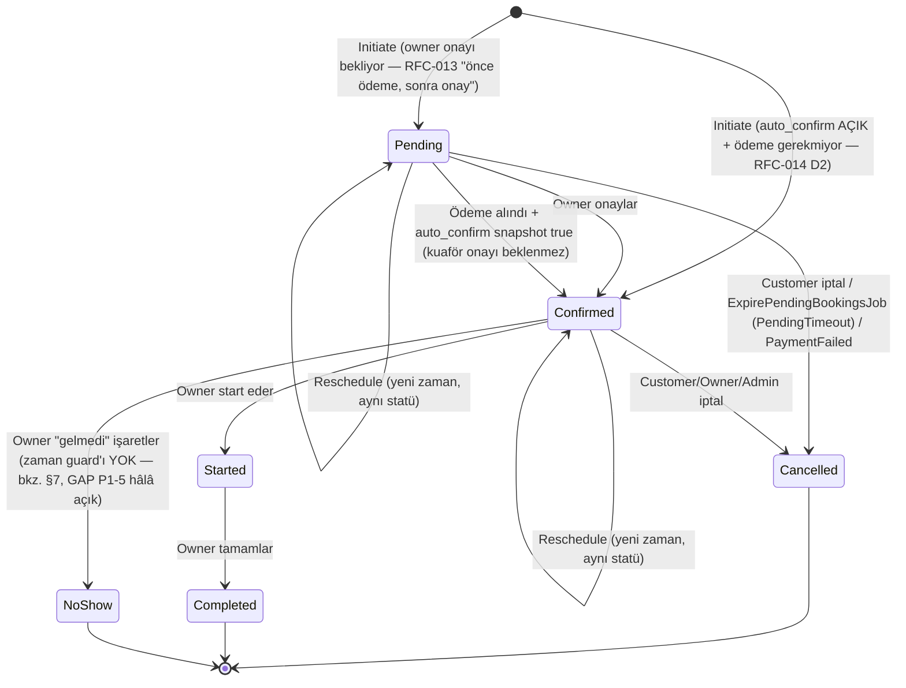

# DOMAIN.md — Randevu & Salon Domain Denetimi (FAZ 1)

**Tarih:** 2026-08-06
**Kapsam:** Otonom geliştirme direktifinin FAZ 1 (domain analizi ve mantık denetimi) çıktısı. Aşağıdaki her iddia backend kodundan (`.NET 8`, `backend/src`, `backend/tests`) dosya:satır kanıtıyla doğrulanmıştır — tahmin veya RFC metninin varsayılan okunması değil, **çalışan kodun** davranışıdır.
**Önkoşul:** `docs/ASSUMPTIONS.md` (direktif ↔ proje eşlemesi) ve `docs/GAP-ANALYSIS.md` (2026-07-23 tam tarama + 2026-08-06'ya kadar nokta güncellemeleri) bu dokümanın tamamlayıcısıdır — burada RFC/GAP içeriği kopyalanmaz, referans verilir.

---

## 1. Randevu (Booking) State Machine — Gerçek Kod

**Kaynak enum'lar:** `backend/src/Kuaforum.Domain/Modules/Booking/BookingStatus.cs`

```csharp
public enum BookingStatus { Pending = 0, Confirmed = 1, Started = 2, Completed = 3, Cancelled = 4, NoShow = 5 }
public enum BookingCancellationReason { CustomerRequested = 0, BarberRequested = 1, PaymentFailed = 2, PendingTimeout = 3, AdminOverride = 4, NoShow = 5 }
public enum BookingType { Scheduled = 0, WalkIn = 1 }
```

Direktifin (BÖLÜM D3) beklediği `REJECTED` ve `EXPIRED` **ayrı statü olarak yok** — ikisi de `Cancelled` durumunun altında `CancellationReason` ile ayrıştırılıyor (`BarberRequested` = ret, `PendingTimeout` = süre doldu). Bu, `docs/ASSUMPTIONS.md` §"Direktif ↔ Mevcut durum eşlemesi" satır D3'te zaten "semantik fark" olarak işaretli — burada kod kanıtıyla doğrulandı, tekrar karar gerektirmiyor (founder onayı istenirse: statü sayısını azaltmak mı, yoksa iki statüyü ayırmak için migration mı — bu DOMAIN.md'nin kapsamı dışında, ayrı bir RFC konusu).

> **Güncelleme 2026-08-07 (RFC-014 §2 D2 — `auto_confirm`):** Salon başına "otomatik onay" ayarı eklendi (`BookingPolicy.AutoConfirmEnabled`, **varsayılan false**). Açıkken `Pending` **atlanabilir**:
>
> - `auto_confirm = true` **ve** ödeme gerekmiyor → `Initiate` doğrudan **`Confirmed`** yaratır, `Pending` hiç oluşmaz.
> - `auto_confirm = true` **ve** kapora/ödeme gerekiyor → randevu yine `Pending` başlar; **ödeme alındığında** kuaför onayı beklenmeden `Confirmed`'a geçer (`Booking.MarkPaymentReceived`). Yani otomatik onay **kuaförün onayını atlar, ÖDEMEYİ ATLAMAZ**.
> - Karar `Initiate` anında `Booking.AutoConfirmSnapshot`'a **donar**: kuaför ayarı sonradan değiştirse bile mevcut randevunun yolu değişmez. `BookingDto.AutoConfirmEnabled` bu snapshot'ı döner (salonun canlı ayarını değil — `2028bb0`).
> - Anti-spam kuralları (RFC-013) otomatik onaydan **etkilenmez**: `Initiate` çağrılmadan önce çalışır, ihlalde randevu hiç oluşmaz.
> - Bildirim metni dallanır: otomatik onaylıda kuaföre "onayınızı bekliyor" değil "otomatik onaylandı" gider.



Kaynak: `Booking.Cancel()`/`Booking.Reschedule()`/`Booking.MarkNoShow()` — `backend/src/Kuaforum.Domain/Modules/Booking/Booking.cs:244-318`; `Reschedule` yalnız Pending/Confirmed'da izinli (satır 262-263).

### 1.1 İptal → İade Yüzdesi Matrisi (`Booking.ComputeRefundPercentage`, `Booking.cs:294-318`)

| `CancellationReason` | İade % | Koşul |
|---|---|---|
| `BarberRequested` | 100 | Koşulsuz |
| `PaymentFailed` | 100 | Koşulsuz |
| `PendingTimeout` | 100 | Koşulsuz |
| `AdminOverride` | 100 | Koşulsuz |
| `NoShow` | 0 | Koşulsuz |
| `CustomerRequested`, owner henüz onaylamamış (`ConfirmedAt == null`) | 100 | RFC-013 C2 revizyonu: onaylanmamış talep için para alıkonmaz |
| `CustomerRequested`, onaylanmış, randevuya ≥24 saat | 100 | — |
| `CustomerRequested`, onaylanmış, randevuya 12-24 saat | 50 | — |
| `CustomerRequested`, onaylanmış, randevuya <12 saat | 0 | — |

`CancellationReason` **her zaman server-side türetilir** — müşteri `BarberRequested`/`AdminOverride` gönderemez (`docs/GAP-ANALYSIS.md` P0-3'ün kapanış hali; `CancelBookingCommand.ResolveReasonAsync`, `BookingActions.cs:60-65`).

---

## 2. Slot ve Uygunluk Kuralları

- **Pending = busy.** `BookingBusyRangeQuery.BlockingStatuses = [Pending, Confirmed, Started]` — `backend/src/Kuaforum.Infrastructure/BackgroundJobs/BookingBusyRangeQuery.cs:14-19`.
- **Otomatik süpürme:** `ExpirePendingBookingsJob` (`backend/src/Kuaforum.Infrastructure/BackgroundJobs/ExpirePendingBookingsJob.cs`), Hangfire cron `*/15 * * * *` (satır 54), üç dallı sweep (satır 63-80):
  1. Kapora bekleniyor + ödenmemiş + `CreatedAt` 30dk+ eski → `Cancel(PendingTimeout)`.
  2. Kapora ödenmiş ama owner onaylamamış + `ScheduledAt` geçmiş → `Cancel(PendingTimeout)`.
  3. Kapora gerekmiyor + `ScheduledAt` geçmiş → `Cancel(PendingTimeout)`.
  - `PendingTimeout = TimeSpan.FromMinutes(30)` (satır 55).
- **"Slot hold" (ayrı, kısa TTL'li geçici tutma tablosu) kodda YOK.** `SlotHold`/`slot_holds`/`HoldSlot` grep'i sıfır sonuç — direktifin D4 beklentisiyle örtüşmüyor, `docs/ASSUMPTIONS.md` bunu zaten bilinen boşluk olarak işaretlemiş; burada teyit edildi. Fiili mekanizma: Pending booking'in kendisi slotu kilitler, iki bağımsız timeout dalı (30dk sabit / randevu-saati bazlı değişken) devreye girer.
- **Müşteri başına eşzamanlı Pending limiti:** global 3 (`InitiateBookingCommand.cs:61,67-72`) + per-shop `BookingPolicy.MaxPendingPerCustomer` (varsayılan 2, RFC-013 C3, aynı dosya satır 185-192).
- **DB garantisi — M15 EXCLUDE constraint:** `backend/src/Kuaforum.Infrastructure/Persistence/Migrations/20260723084553_M15_BookingSlotExclusion.cs:34-42`
  ```sql
  ALTER TABLE bookings ADD CONSTRAINT ex_bookings_stylist_slot
    EXCLUDE USING gist (stylist_id WITH =, tstzrange(scheduled_at, scheduled_ends_at, '[)') WITH &&)
    WHERE (status IN (0, 1, 2));  -- Pending, Confirmed, Started
  ```
  Redis distributed lock (`slot-lock:{StylistId}`, `InitiateBookingCommand.cs:107-110`) yalnız "fast path" — nihai garanti DB constraint'i. İhlal (Postgres `23P01`) `PostgresErrorClassifier.IsExclusionViolation` ile yakalanır → `Error.Conflict(...)` → HTTP 409 (`InitiateBookingCommand.cs:158-166`; `BookingEndpoints.cs:39,53`).
  - Concurrency kanıtı: `backend/tests/Kuaforum.Tests.Integration/BookingSlotSafetyTests.cs` — hem lock'lu (`Concurrent_initiate_same_stylist_overlapping_slots_exactly_one_succeeds`) hem lock bypass edilmiş (`Exclude_constraint_alone_rejects_overlap_when_the_app_level_lock_is_bypassed`) senaryoda tam 1 başarı + 1×409/23P01 garantisi test edilmiş.
- **Stylist bazlı kontrol var, müşteri bazlı (cross-shop) kontrol YOK.** `BookingBusyRangeQuery` yalnız `stylistId` filtreler, `CustomerId` filtresi yok (`BookingBusyRangeQuery.cs:29`) — detay §3 Soru 5.

---

## 3. 12 Domain Sorusu — Kanıtlı Cevaplar

### S1 — Salon onaylamazsa slot açık mı, kilitli mi?

**Kilitli, ama süreli.** Pending booking slotu tamamen kilitler (§2). Kilit en fazla 30dk (ödeme yoksa, `CreatedAt` bazlı) veya randevu saatine kadar (kapora ödenmiş ama owner onaylamamışsa, `ScheduledAt` bazlı) sürer; `ExpirePendingBookingsJob` 15 dakikada bir tarar ve otomatik `Cancelled(PendingTimeout)` yapar → iade %100. EXCLUDE constraint Pending'i kapsıyor (`status IN (0,1,2)`).

### S2 — Salon randevu saatine yakın iptal ederse müşteriye ne olur?

**Bildirim + otomatik iade, tam otonom.**
1. Owner cancel → `CancelBookingCommand` içinde reason server-side `BarberRequested` türetilir (`BookingActions.cs:60-65`) → `Booking.Cancel()` → `BookingCancelledEvent` (`Booking.cs:252`).
2. `BookingCancelledNotificationHandler` müşteriye InApp+Push gönderir, iade metnini yazar (`BookingNotificationHandlers.cs:170-222`).
3. `BookingCancelledRefundHandler` aynı event'i yakalar → `enqueuer.EnqueueRefund(bookingId)` (`backend/src/Kuaforum.Application/Modules/Payment/BookingCancelledRefundHandler.cs:20-27`).
4. Hangfire `ProcessBookingRefundJob` (`[AutomaticRetry(Attempts = 5)]`, `backend/src/Kuaforum.Infrastructure/BackgroundJobs/ProcessBookingRefundJob.cs:24-56`) → `BookingRefundService.RefundIfEligibleAsync` → `payment.AddRefund(...)` + gerçek PSP `provider.RefundAsync(...)` çağrısı (`backend/src/Kuaforum.Application/Modules/Payment/BookingRefundService.cs:88-113`).

Manuel admin/PSP müdahalesi **gerekmiyor** — zincir event-driven ve tam otomatik. Not: `docs/GAP-ANALYSIS.md` P0-4 bunu "otomasyon yok" olarak işaretlemişti (2026-07-23); bu madde CLAUDE.md Cycle 9 notunda kapatıldığı belirtilmiş ve burada **güncel kod üzerinden yeniden doğrulandı** — kapanış geçerli.

### S3 — Çalışan (Stylist) işten ayrılırsa gelecek randevuları ne olur?

**Hiçbir şey olmuyor — sessizce askıda kalıyor.** `Stylist.IsActive` + `SetActive(bool)` var (`backend/src/Kuaforum.Domain/Modules/Barber/Stylist.cs:14,47-53`), `UpdateStylistCommandHandler` (`StylistCommands.cs:63-93`) bunu çağırabiliyor — ama handler'da booking tablosuna dokunan **hiçbir kod yok**. Otomatik iptal, otomatik devir (başka stylist'e reassign) veya event tabanlı bir tepki **YOK** (grep `StylistDeactivat*`/`ReassignStylist`/`CancelBookingsForStylist` → 0 sonuç). Mobile UI bu davranışı bilinçli olarak metne döküyor: `mobile/app/(barber)/availability.tsx:515` → *"Pasif çalışan müşterilere görünmez. Aktif randevuları etkilenmez."* — yani "dokunma" ürün kararı olarak seçilmiş, ancak var olan Confirmed randevuların artık pasif bir stylist'e asılı kalmasını telafi eden bir mekanizma yok. Bkz. `docs/GAPS.md` G3.

### S4 — Salon komisyon borcu nedeniyle askıya alınırsa mevcut randevular ne olur?

- **Eşik:** `SuspendOverdueCommissionAccountsJob` günlük 03:00 çalışır (cron `0 3 * * *`), `CommissionStatement.Status IN (Notified, Overdue)` ve `DueDate < today` olan hesapları tarar; `DueDate = periodEnd + 7 gün` (`CommissionStatement.cs:66`) — `SuspendOverdueCommissionAccountsJob.cs:39,52-61`.
- **Mevcut randevular: dokunulmuyor.** `BarberShop.Suspend()` yalnız `Status = Suspended` set eder (`BarberShop.cs:128-135`); job dosyasında `Booking` referansı hiç yok. Confirmed/Pending randevular hiçbir şekilde iptal edilmiyor.
- **Arama/keşfette görünürlük: kayboluyor.** `SearchBarbersQuery` + `GetPublicBarberShopBySlugQueryHandler` + `GetPublicBarberShopsQuery` hepsi `Status == Active` filtreliyor (`SearchBarbersQuery.cs:62`, `GetPublicBarberShopQueries.cs:101,126-129,199`) — Suspended salon aramada görünmez, public profili 404 döner (bilgi sızıntısını önlemek için Draft/PendingKyc/Closed ile aynı 404).
- **Mevcut müşteri randevu detayına erişebiliyor, YENİ randevu alamıyor.** `GetBookingByIdQueryHandler` shop `Status`'üne hiç bakmıyor — eski randevu detayı erişilebilir kalıyor (`GetBookingQueries.cs:144-206`). `InitiateBookingCommand.cs:78-80` yeni randevuyu `shop.Status != Active` ise reddediyor.
- **Bildirim: yalnız owner'a gidiyor, müşteriye gitmiyor.** `CommissionStatementSuspendedNotificationHandler` (`BillingNotificationHandlers.cs:44-68`) yalnız `shop.OwnerId`'e gönderiyor. Bkz. `docs/GAPS.md` G6.

### S5 — Müşteri aynı saatte iki farklı salona randevu alabilir mi?

**Evet, engelleyen hiçbir kontrol yok.** `InitiateBookingCommand.cs:112` ve `BookingBusyRangeQuery.cs:29` yalnız `stylistId` bazlı çakışma kontrolü yapıyor; `CustomerId` filtresi yok. Aktif Pending sayaç kontrolü (global 3 / per-shop 2) zamandan bağımsız, yalnız toplam sayıyı sınırlıyor — aynı saat aralığında farklı salon/stylist'e randevu almayı engellemiyor. Bkz. `docs/GAPS.md` G1.

### S6 — Salon çalışma saatini değiştirirse mevcut randevular ne olur?

**Sessizce hiçbir şey — uyarı yok, kontrol yok.** `SetWorkingHoursCommandHandler` (`ServiceCommands.cs:181-210`) yalnız `WorkingHours` entity'sini günceller, `Booking` tablosuna hiç sorgu/yazma yapmıyor. Yeni saatlerin dışında kalan onaylı randevular flag'lenmiyor veya iptal edilmiyor. Bkz. `docs/GAPS.md` G2.

### S7 — Hizmet süresi değişirse mevcut randevuları etkiler mi?

**Hayır — Initiate anında snapshot alınıyor.** `BookingItem` kendi `DurationMinutes`/`ServiceName`/`PriceMinor`/`BufferMinutes` alanlarına sahip (`Booking.cs:321-345`); `Booking.Initiate()` bu değerleri o anki `ServiceCatalog` satırından kopyalıyor (`Booking.cs:118`). `Booking.ScheduledEndsAt` da Initiate anında sabitleniyor (`Booking.cs:92,102`). `UpdateServiceCommandHandler` (`ServiceCommands.cs:76-101`) yalnız `ServiceCatalog`'u günceller, mevcut booking'e dokunmuyor.

### S8 — Salon hizmeti silerse geçmiş randevularda hizmet adı nasıl görünür?

**Soft-delete + tam snapshot — geçmiş kayıt değişmiyor.** `DeleteServiceCommandHandler` hard-delete değil, `service.SetActive(false)` (`ServiceCommands.cs:133`, `ServiceCatalog.cs:70`). `BookingItem.ServiceName` Initiate anında kopyalanan bağımsız bir string (§S7); `GetBookingByIdQueryHandler`/`GetMyBookingsQueryHandler` bu alanı doğrudan `BookingItem`'dan okuyor, `ServiceCatalog`'a canlı join yapmıyor (`GetBookingQueries.cs:125,194`). Servis silinse/deaktive olsa bile geçmiş randevuda eski ad aynen kalır — "Silinmiş hizmet" fallback'ine gerek yok çünkü zaten canlı okuma yok.

### S9 — Müşteri salonun kapalı/kuaförün gelmediğini fark ederse ne yapar?

**YOK — müşteri tarafı raporlama mekanizması hiç yok.** Repo genelinde `Dispute` yalnız `CommissionStatement.Dispute(...)` içinde var (`CommissionStatement.cs:126`) — bu owner'ın **platforma komisyon faturasına** itirazı, müşteri-tarafı şikayet değil. `MarkNoShowCommand` **ters yönde** çalışıyor: yalnız owner çağırabiliyor, müşterinin gelmediğini işaretliyor (`BookingActions.cs:169-199`). `Complaint`/`SupportTicket`/`BarberNoShow` terimleriyle eşleşen hiçbir entity/endpoint yok. Bkz. `docs/GAPS.md` G4.

### S10 — Sahip aynı zamanda tek çalışansa çalışan yönetimi ekranı nasıl davranır?

**Otomatik Stylist kaydı oluşturulmuyor — owner elle eklemek zorunda.** `CreateBarberShopCommand` (`CreateBarberShopCommand.cs:37-89`) yalnız `BarberShop.Create` + rol terfisi yapıyor, `Stylist.Create` çağrısı yok. Mobile'da owner "+ Yeni çalışan" ile kendini elle ekliyor (`mobile/app/(barber)/availability.tsx:284-291,460-492`). Bu adım atlanırsa salon `StylistCount=0`, `HasWalkInAvailable=false` olarak arama sonuçlarında görünür (`SearchBarbersQuery.cs:97-105`) — walk-in differentiator'ı fiilen kapalı kalır. Bkz. `docs/GAPS.md` G5.

### S11 — İki müşteri aynı milisaniyede aynı slota basarsa ne olur?

Bkz. §2 (EXCLUDE constraint detayı). Özet: Redis lock "fast path" + Postgres `EXCLUDE USING gist (... WHERE status IN (0,1,2))` nihai garanti; ihlal `23P01` → `Error.Conflict` → HTTP 409 kullanıcı mesajı "Bu saat az önce doldu...". `BookingSlotSafetyTests.cs` içindeki testler hem lock'lu hem lock-bypass senaryoda constraint'in tek başına yeterli olduğunu kanıtlıyor (1 başarı + 1×409, DB'de tek aktif kayıt).

### S12 — Telefonu değişen müşterinin geçmiş randevuları ne olur?

**Değişmiyor çünkü zaten snapshot değil — canlı FK ile okunuyor, otomatik güncel kalır.** Telefon değiştirme akışı var: `InitiatePhoneChangeCommand`/`ConfirmPhoneChangeCommand` (`PhoneChangeCommand.cs:11,73`), OTP tabanlı, rate limit 3/saat. `Booking` entity'sinde telefon alanı **yok** — `BookingDto.CustomerPhone` her sorguda `User.PhoneE164`'ten canlı okunuyor (`GetBookingQueries.cs:81-84,166-169`). Yani telefon değişince geçmiş randevu kayıtlarında görünen telefon da otomatik güncellenmiş olur (User'a `UserId` ile bağlı, ayrı bir snapshot tutulmuyor). Audit: hem initiate hem confirm audit'e yazılıyor (`"user.phone.change.initiated"`/`"...confirmed"`, `PhoneChangeCommand.cs:60-66,114-120`). Bu davranış bir gap değil — bilinçli/doğru tasarım (randevu geçmişinde güncel iletişim bilgisi kalması istenir).

---

## 4. Doğrulamalar (Direktif D2-D6)

### A) Stylist kullanıcı girişi/paneli

**YOK — `docs/ASSUMPTIONS.md`'nin iddiası doğrulandı.** `UserRole.Stylist = 2` tanımlı (`UserRole.cs:7`) ama repo genelinde hiçbir yerde bir kullanıcıya **atanmıyor** — `grep "UserRole.Stylist"` 3 sonuç, üçü de negatif/açıklayıcı bağlam (`User.PromoteToBarberOwner()` guard'ı + iki test yorumu, `User.cs:112`). Seeder'larda da atama yok. `AuthSetup.cs:50`'deki `"Stylist"` policy'si aslında `RequireRole("Stylist", "BarberOwner")` — kod yorumunda itiraf edildiği gibi (`BarberEndpoints.cs:221`) bu grubu fiilen yalnız **owner** çağırabiliyor, çünkü gerçek Stylist rolüne sahip hiçbir hesap yok. Mobile'da ayrı bir stylist girişi/route yok (`(barber)` = owner paneli, `(tabs)` = müşteri). **Sonuç: `Stylist` yalnızca owner'ın yönettiği bir kaynak/kayıt — kendi login'i, kendi paneli, kendi JWT rolü olan bağımsız bir kullanıcı tipi değil.** Bkz. `docs/GAPS.md` G7 (isimlendirme + founder karar ihtiyacı).

### B) Backend free-text arama + TR normalizasyon

**İkisi de YOK — yalnız yapısal filtre.** `SearchBarbersQuery` parametreleri: `CityId`, `DistrictId`, `GenderType`, `OpenWalkInOnly`, `MinRating`, `MaxPriceMinor`, `Page/PageSize` (`SearchBarbersQuery.cs:12-20`) — isim/hizmet metniyle arama yok. `search_normalized`/`pg_trgm`/`unaccent` grep'i backend'de sıfır sonuç; tek "normalize" alanı `User.EmailNormalized` (login amaçlı, aramayla ilgisiz). Mobile'daki `normalizeTr` (`mobile/src/lib/format.ts:108-115`) yalnız önceden çekilmiş şehir listesini client-side filtrelemek için kullanılıyor (`(tabs)/index.tsx:236-237`) — backend'e giden bir sorgu değil. Bu, `docs/ASSUMPTIONS.md`'nin RFC-002 referansıyla ("MVP'de yalnız yapısal filtre") birebir örtüşüyor; yeni bulgu yok, doğrulama.

### C) Slot hold (TTL'li geçici tutma)

**YOK.** Bkz. §2. `docs/ASSUMPTIONS.md` D4 satırında zaten bilinen boşluk olarak kayıtlı; burada iki farklı timeout mekanizmasının (30dk sabit / randevu-saati bazlı değişken) var olduğu netleştirildi — bu nüans önceki dokümanda yoktu.

### D) Bildirimlerde sessiz saat + idempotency + günlük özet

- **Sessiz saat (22:00-08:00): YOK.** `NotificationDispatcher.DispatchAsync` (`NotificationDispatcher.cs:16-51`) zaman kontrolü yapmadan direkt gönderiyor; `QuietHours`/`SilentHours` grep'i sıfır gerçek sonuç.
- **Idempotency: merkezi değil, iş bazında var.** `NotificationDispatcher`'ın kendisinde dedup yok; ama `BookingReminderJob` göndermeden önce `NotificationLog`'da `TemplateKey + RelatedBookingId` kontrolü yapıyor (`BookingReminderJob.cs:44-51`, yorumda "Idempotent via NotificationLog row check"). Diğer event-driven handler'ların (booking/KYC/billing) aynı korumaya sahip olup olmadığı bu turda doğrulanmadı `[unverified 2026-08-06 — needs handler-by-handler check]`.
- **Günlük özet (digest): YOK.** Hangfire recurring job listesinde (`DependencyInjection.cs:284-320`) digest/summary job yok; kod tabanındaki tek "digest" referansı (`marketing.weekly_digest`) yalnız demo seeder örnek verisi, gerçek bir job tarafından üretilmiyor.

---

## 5. Para Modeli — Referans Özeti (detay için RFC'lere bakın, burada kopyalanmadı)

| Konu | Kaynak | Not |
|---|---|---|
| Randevu-bazlı kapora/tam ödeme | `docs/rfc/RFC-006-kapora-checkout.md` + `docs/rfc/RFC-013-per-shop-deposit-and-booking-rules.md` | `PaymentKind.FullOnline\|Deposit`, per-shop kapora oranı, "önce ödeme, sonra owner onayı" (RFC-006'nın "anında onay" varsayımı RFC-013 ile terk edildi) |
| Aylık ciro komisyonu | `docs/rfc/RFC-012-monthly-commission-billing.md` | `CommissionStatement` state machine: `Open → Notified → Paid \| Overdue → SuspensionApplied → Paid` (`CommissionStatement.cs:6-13,22-24`) |
| V1 online ödeme kapalı | `docs/rfc/RFC-009-free-growth-mode.md` | `Payment:OnlinePaymentsEnabled=false` varsayılan — direktifin D1 "V1'de müşteri in-app ödeme yapmaz" beklentisiyle uyumlu |
| İki mekanizma ayrı mı? | Kod: `Payment` (randevu ödemesi) vs `CommissionPayment` (aylık komisyon) | **Evet, iki ayrı aggregate.** `CommissionPayment.cs:15-17` doc-comment: "sibling aggregate — Payment invariantlarına dokunmaz, yalnız `IPaymentProvider` arayüzünü paylaşır." `CommissionPayment` bugün yalnız Mock provider ile test ediliyor. |

---

## Bağlantılar

- `docs/ASSUMPTIONS.md` — direktif ↔ proje eşlemesi (bu dokümanın önkoşulu)
- `docs/GAP-ANALYSIS.md` — 2026-07-23 tam tarama + nokta güncellemeleri (P0/P1/P2 madde numaraları burada referans verildi, kopyalanmadı)
- `docs/GAPS.md` — bu FAZ 1 taramasında bulunan YENİ boşluklar
- `docs/PROGRESS.md` — güncel durum özeti
- `docs/decisions/ADR-001-direktif-uyarlama.md` — direktifin projeye uyarlanma kararı
- `docs/rfc/RFC-006, 007, 009, 012, 013` — para modeli ve onboarding kararları

**Son güncelleme:** 2026-08-06
