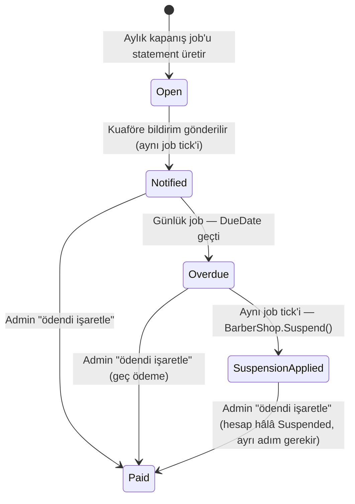

# RFC-012 — Aylık Ciro Komisyonu: Ücretsiz Kayıt + Ay Sonu Statement + Otomatik Yaptırım

**Status:** ✅ Accepted — founder onayı 2026-08-05
**Tarih:** 2026-08-05
**Kapsam:** `Kuaforum.Domain/Modules/Billing` (yeni modül — `CommissionStatement`), `Kuaforum.Domain/Modules/Barber` (`BarberShop` — komisyon oranı override alanı), `Kuaforum.Application/Modules/Billing` (yeni), `Kuaforum.Infrastructure/BackgroundJobs` (aylık kapanış + günlük vade-kontrol job'ları), `Kuaforum.Api` (owner borç ekranı + admin tahsilat kuyruğu endpoint'leri), `mobile/app/(barber)/` (borç ekranı), `web-admin/` (tahsilat kuyruğu, oran/statement yönetimi)
**İlgili:** [RFC-006](RFC-006-kapora-checkout.md) (kapora+komisyon+webhook mimarisi — bu RFC ile komisyon kesintisi RFC-006'dan sökülüyor, kapora artık tamamen kuaföre akıyor), [RFC-009](RFC-009-free-growth-mode.md) (online ödeme feature-flag'i — launch master-switch olarak aynen kalıyor, bu RFC'yi süpersedelemiyor), [RFC-013](RFC-013-per-shop-deposit-and-booking-rules.md) (per-shop kapora ayarı — bu RFC'nin tanıttığı `PlatformSettings` admin-sınır mekanizmasını paylaşır), [`09-payment/02-commission-model.md`](../09-payment/02-commission-model.md) (MVP komisyon modeli — bu RFC ile **çelişiyor**, güncellenmesi gerekiyor, aşağıda not edildi)

---

## Kararlar (founder, 2026-08-05)

1. Kuaför kaydı ücretsiz "aylık abonelik" — upfront ücret yok. Platform her randevuyu kaydeder; ay sonunda kuaför o ayki kazancının **%X'ini** platforma öder. Oran **admin-ayarlı global değer** (örnek %20), **kuaföre özel override** mümkün.
2. **Matrah: yalnız o ay `Completed` olan randevuların toplam bedeli.** İptal, no-show, onaylanmamış (Pending/Cancelled) randevular matraha girmez — founder onaylı, net.
3. **Dönem kapanışı:** her ayın sonunda kuaför başına statement (dönem, matrah, oran, borç) oluşur + kuaföre bildirim. **Son ödeme tarihi = kapanış + 7 gün.**
4. **Yaptırım:** vade + 7 gün geçen ödenmemiş statement → hesap **otomatik pasife** düşer (mevcut Suspend mekanizması; arama/keşiften düşer, yeni randevu alamaz). Ödeme admin'ce onaylandığında **admin ayrıca aktifleştirir** (iki ayrı adım — "ödendi işaretle" aktivasyonu otomatik tetiklemez). **Tüm yetki adminde:** oran değiştirme, borç silme/düzeltme, manuel suspend/aktifleştirme, vade uzatma.
5. **Tahsilat çift kanal** ("paytr altyapısı olsun ve admin onayı"):
   - **(a) MVP'den itibaren havale/EFT** — kuaför panelinde borç ekranı (IBAN, tutar, son tarih, dekont bildirimi); admin panelinde tahsilat kuyruğu + "ödendi işaretle".
   - **(b) PayTR online ödeme İSKELETİ** — RFC-006'nın checkout/webhook altyapısı komisyon ödemesine uyarlanır; merchant hesabı gelince config'le aktifleşir.

## Mevcut durum (kod kanıtı — bu RFC'nin üzerine kurulduğu zemin)

- `BarberShop.CommissionTier` bugün tek değer `"standard"` (`BarberShop.cs:28,42`) — gerçek bir oran mekanizması değil, RFC-009'un bıraktığı yer tutucu.
- Komisyon bugün **booking-time snapshot**: `Booking.Initiate(...)` çağrıldığında `PaymentAmounts.CalculateCommissionMinor(totalAmount, commissionRate)` ile hesaplanıp `Booking.PlatformCommissionMinor`'a yazılıyor (`Booking.cs:47-63`), `commissionRate` de `PaymentOptions.CommissionRate` config değerinden geliyor. Ayrıca `Payment.PlatformCommissionMinor` aynı değeri taşıyıp `NetToBarberMinor = GrossAmountMinor - PlatformCommissionMinor - PspMdrMinor` hesabında kullanılıyor (`Payment.cs:19-20,78`) — yani komisyon bugün **ödeme anında, tek transaction'dan** kesiliyor.
- `BarberShop.Suspend(reason)` / `Reactivate()` zaten üretim kodunda var (`BarberShop.cs:110-124`) ve `SuspendBarberShopCommand` / `ReactivateBarberShopCommand` admin akışıyla çalışıyor (`SuspendBarberShopCommand.cs`) — bu RFC yeni bir suspend mekanizması icat etmiyor, mevcut olanı sistem-tetikli bir yoldan çağırıyor.
- Sistem-tetikli (admin'siz) audit kaydı deseni zaten var: `AutoNoShowJob`, `actorUserId: null` ile audit yazıyor (`AutoNoShowJob.cs:47-52`) — bu RFC'nin günlük vade job'u aynı deseni kullanır.
- Hangfire recurring job kayıt deseni: `DependencyInjection.RegisterRecurringJobs` içinde `manager.AddOrUpdate<TJob>(...)` + `RecurringJobOptions { TimeZone = TimeZoneInfo.Utc }` (`DependencyInjection.cs:260-285`). Günlük job cron örneği: `HardDeleteUsersJob` → `"0 3 * * *"` (03:00 UTC).
- Komisyon tek doğruluk kaynağı `PaymentAmounts.CalculateCommissionMinor` — sınıfın kendi doc-comment'i "Booking.Initiate dahil her komisyon/kapora hesabı buradan geçer" diyor (`PaymentAmounts.cs`). Bu RFC bu kuralı bozmuyor; `CommissionStatement` da aynı helper'ı çağırır.

## Tasarım

### Domain — `CommissionStatement` (yeni agregat, `Kuaforum.Domain/Modules/Billing`)

| Alan | Tip | Not |
|---|---|---|
| `Id` | Guid | |
| `BarberShopId` | Guid | |
| `PeriodStart` / `PeriodEnd` | DateOnly | Takvim ayı sınırları (örn. 2026-08-01 – 2026-08-31) |
| `BasisAmountMinor` | long | Matrah — dönemde `Completed` olan randevuların `TotalAmountMinor` toplamı |
| `RateApplied` | decimal | Kapanış anında **snapshot'lanır** (per-shop override ?? global oran) — sonraki oran değişiklikleri geçmiş statement'ı etkilemez, RFC-006'nın `DepositRate` snapshot presedentiyle aynı ilke |
| `AmountDueMinor` | long | `PaymentAmounts.CalculateCommissionMinor(BasisAmountMinor, RateApplied)` — **tek kaynak, yeni yuvarlama mantığı icat edilmiyor** |
| `DueDate` | DateOnly | `PeriodEnd + 7 gün` — job'un çalışma anına değil, dönem sonuna bağlı (job gecikse bile vade sabit) |
| `Status` | enum | `Open → Notified → Paid \| Overdue → SuspensionApplied` (aşağıda state machine) |
| `IsDisputed` / `DisputeNote` / `DisputedAt` | bool/string?/DateTimeOffset? | İtiraz bayrağı — ayrı bir status DEĞİL (aşağıda gerekçe) |
| `AdminAdjustmentNote` | string? | Admin borç düzeltmesi yaptıysa gerekçe (audit'e de yazılır) |

**Matrah kapsamı — açıkça netleştirilmesi gereken nokta:** `BookingType.WalkIn` dahil, **tüm** `Completed` randevular matraha girer. Hariç tutulsaydı "walk-in" olarak işaretleyip komisyondan kaçma kapısı açılırdı — bu, aşağıdaki "platform-dışına kaçırma" riskinin bir varyantı, RFC bunu baştan kapatıyor.

**State machine:**

`Paid` durumuna geçiş **hesabı otomatik aktifleştirmez** — founder'ın "ödeme admin'ce onaylanınca admin aktifleştirir" cümlesi iki ayrı eylem tarif ediyor. Admin, mevcut `ReactivateBarberShopCommand`'ı ayrı bir tıkla çağırır (Why: admin ödemeyi onaylarken başka bir sorun fark edebilir — örn. dekont tutarı eksik, hesapla ilgili ayrı bir şikayet var — otomatik aktivasyon bu kontrolü atlar).

**İtiraz neden ayrı bir status değil, bir bayrak:** `[ara karar]` İtiraz açıldığında vade sayacı **otomatik durmuyor** — yalnızca admin'in mevcut "vade uzatma" aracı (madde 4, "tüm yetki adminde") sayacı durdurabilir. Gerekçe: otomatik durdurma, "itiraz et" butonunu ödemeden kaçınma aracına çevirir (her ay sonunda itiraz açıp 7 gün+admin-inceleme süresi kazanma). Admin'in elle vade uzatması zaten yeterli güvenlik supabı; itiraz sırasında `Overdue`/`SuspensionApplied`'a geçiş normal akışında devam eder, admin dispute kuyruğunda görür ve isterse düzeltir/vade uzatır.

### Domain — `BarberShop` genişletmesi

- `CommissionRateOverride` (decimal?, null = global oranı miras alır) — yeni alan.
- `CommissionTier` alanı **dokunulmuyor** (RFC-009 kararı geçerli — V1.5 tier modeli için ayrı iş).

### Yeni admin-ayarlı global konfigürasyon — `PlatformSettings`

`[ara karar]` Global komisyon oranı **appsettings `PaymentOptions.CommissionRate` DEĞİL**, yeni DB-backed `PlatformSettings` (tek satır veya anahtar-değer tablo). Gerekçe: founder "admin-ayarlı" dedi — `PaymentOptions` bugün `IOptions`, yalnız config dosyası + restart ile değişiyor, self-servis admin ekranına uygun değil. Ayrıca `PaymentOptions.CommissionRate` artık RFC-006'nın kapora-gömülü komisyon modelinin kalıntısı (bkz. RFC-006 çapraz notu — kapora artık komisyon kesmiyor); bu RFC'nin komisyon oranı kavramsal olarak **ayrı bir değer**, aynı config anahtarını yeniden kullanmak iki farklı anlamı aynı isimde çakıştırır.

`PlatformSettings` bu RFC'de yalnız `CommissionRateGlobal` (decimal) taşır; [RFC-013](RFC-013-per-shop-deposit-and-booking-rules.md) aynı mekanizmayı `DepositPercent`/`MaxPendingPerCustomer` gibi admin-sınır alanlarıyla genişletir — iki RFC arasında paylaşılan tek bir admin-config altyapısı, iki ayrı tablo değil.

### Jobs (Hangfire)

- **`CloseMonthlyCommissionStatementsJob`** (aylık, cron `"15 0 1 * *"` UTC — ayın 1'i 00:15): önceki ayı kapatan dönem için, o dönemde en az bir `Completed` randevusu olan her `BarberShop` için `CommissionStatement.Open` oluşturur → aynı tick'te `Notified`'a geçer + bildirim event'i (`CommissionStatementNotifiedEvent`) yayar. Sıfır-matrahlı shop'lar için statement üretilmez (gürültü önleme).
- **`SuspendOverdueCommissionAccountsJob`** (günlük, cron `"0 3 * * *"` — `HardDeleteUsersJob` presedenti): `Status == Notified && DueDate < bugün` → `Overdue`; hemen ardından `shop.Suspend("commission_overdue:" + statement.Id)` çağrılır (mevcut domain metodu, reason parametresi mevcut `SuspendBarberShopCommand` deseniyle audit'e yazılır, entity şemasında saklanmaz — `BarberShop.Suspend` bugün de böyle çalışıyor) → statement `SuspensionApplied`. Audit `actorUserId: null` (`AutoNoShowJob` presedenti — sistem eylemi, admin değil).

### Bildirimler

- Mevcut domain-event → notification-handler zinciri (`KycNotificationHandlers`, `BookingNotificationHandlers` presedenti) genişletilir: `CommissionStatementNotifiedEvent` → kuaföre push + panel bildirimi ("Ağustos dönemi komisyon borcunuz: X TL, son ödeme Y"); `CommissionStatementSuspendedEvent` → "Hesabınız ödenmemiş komisyon borcu nedeniyle askıya alındı."

### Owner paneli — borç ekranı

- Açık/geciken statement'lar listesi (dönem, matrah, oran, tutar, vade, durum).
- Platform IBAN + banka adı + statement referans kodu (dekont açıklamasına yazılması istenen kod — admin'in dekontu doğru statement'a eşlemesi için) — `PlatformSettings`'e eklenen `CommissionPaymentIban`/`BankName`/`AccountHolderName` alanlarından okunur (admin değiştirebilir, banka değişirse deploy gerekmez).
- Dekont bildirimi: mevcut KYC upload deseni yeniden kullanılır (`POST /v1/uploads/kyc` presedenti, RFC-007) — yeni bir dosya yükleme altyapısı icat edilmiyor, yalnız hedef kaydı `CommissionStatement` olur.
- "İtiraz et" butonu → `DisputeNote` + admin kuyruğuna düşer.

### Admin paneli — tahsilat kuyruğu

- Statement listesi (mevcut KYC admin kuyruğu / `PagedResult` deseni — Cycle 9), filtre: Notified / Overdue / Disputed / Paid.
- Randevu bazlı döküm: **ayrı bir line-item tablosu YOK** (YAGNI) — `Booking` tablosu zaten `BarberShopId + Status=Completed + CompletedAt` ile sorgulanabilir immutable bir kayıt; statement yalnız agregatı saklar, döküm ekranı bunun üzerine bir read-model sorgusu. `Why:` iki kaynağı (statement satırları + booking tablosu) senkron tutmanın maliyeti, tek sorguyla türetmenin maliyetinden yüksek.
- Admin aksiyonları (hepsi `AdminUserId` + `Reason` zorunlu, `SuspendBarberShopCommand` deseniyle audit'li): "ödendi işaretle" (`MarkCommissionStatementPaidCommand`), "tutarı düzelt" (`AdjustCommissionStatementAmountCommand`), "vade uzat" (`ExtendCommissionStatementDueDateCommand`), "oranı değiştir" (global `PlatformSettings.CommissionRateGlobal` veya `BarberShop.CommissionRateOverride`).

### PayTR online ödeme iskeleti (madde 5b)

Founder'ın kendi ifadesiyle bu bir **iskelet** — tam şema bu RFC'de kilitlenmiyor, ama iki gerçek mimari seçenek var, ikisi de not edilmeli:

| Seçenek | Artı | Eksi |
|---|---|---|
| **A — `Payment.BookingId`'i nullable yap + `CommissionStatementId` ekle** | Tek `Payment` agregatı, mevcut webhook/HMAC kodu değişmeden çalışır | `Payment.Initiate` imzası ve her mevcut booking-payment çağrı noktası nullable-check riski taşır (RFC-006'nın test edilmiş kodu) |
| **B — Sibling `CommissionPayment` agregatı** | `Payment`'ın invariant'larına dokunmaz; `IPaymentProvider`/webhook HMAC doğrulama kodu (arayüz seviyesinde) paylaşılır | Yeni tablo + yeni webhook route + kısmen tekrar eden capture/refund mantığı |

`[ara karar — backend implementasyon RFC'sinde netleştirilmeli]` **B eğilimliyim** — `Payment` bugün RFC-006'nın uçtan uca test edilmiş yolunda, `BookingId` invariantını gevşetmek regresyon riski taşır; `IPaymentProvider` arayüzü (`InitiateAsync`/`VerifyAsync`/`RefundAsync`) zaten agregat-agnostik, paylaşılabilir. Bu RFC bu seçimi **kilitlemiyor** — merchant hesabı bağlandığında ayrı bir kısa RFC/implementasyon planıyla netleşir.

### Test (implementasyon aşamasında)

- Domain: matrah hesabı (yalnız Completed, walk-in dahil), `RateApplied` snapshot (override > global), `AmountDueMinor` rounding = `PaymentAmounts` ile birebir.
- Integration: aylık kapanış job — sıfır-matrahlı shop atlanır; günlük vade job — `Notified→Overdue→SuspensionApplied` zinciri + `Suspend()` çağrısı + audit `actorUserId: null`; admin "ödendi işaretle" hesabı **otomatik aktifleştirmiyor** (regresyon testi — bu davranış kolayca yanlış varsayılabilir); vade uzatma sonrası job'un statement'ı atlaması.

## Why

Founder'ın "ücretsiz büyüme, sonra tahsil et" stratejisi (RFC-009) ile "platform gelir modeli olsun" ihtiyacı arasındaki gerilimi çözüyor: PSP'siz de çalışan bir tahsilat mekanizması (havale/EFT + admin onayı) launch'ı bloklamıyor, PayTR geldiğinde iskelet üzerine inşa ediliyor. Matrahı yalnız `Completed` randevularla sınırlamak kuaförü riske atmıyor (iptal/no-show için komisyon yok) ve mevcut booking state machine'inin zaten tek-yönlü olması (`Completed` sonrası `Cancel` yok — `Booking.cs:139`) sayesinde matrah geriye dönük bozulmuyor. Otomatik suspend, manuel takip yükü olmadan "ödemeyen kuaför aramada kalmaya devam eder" riskini kapatıyor; tüm düzeltme yetkisinin adminde kalması (oran, borç, vade) tek bir insan onayı olmadan hiçbir hesabın kalıcı zarar görmemesini garanti ediyor.

**Bilinen risk (dürüstçe):** platform-dışına kaçırma — kuaför müşteriyi telefonla/WhatsApp'la alıp platform dışında anlaşırsa (randevuyu hiç oluşturmaz veya oluşturup `Completed`'e hiç çekmez) bu model onu tespit edemez. Bu bir yaptırım sorunu değil, ürün değeri sorunu: platform üzerinden randevu almanın kuaföre kattığı değer (keşfedilebilirlik, hatırlatma, no-show azaltma, ödeme kolaylığı) kaçırmaktan daha cazip olmalı. V2'de tespit sinyalleri (örn. profil görüntülenme/randevu oranı anomalisi) düşünülebilir — bu RFC'nin kapsamı dışında, bilinçli bırakılıyor.

## How to apply

Sıra: `PlatformSettings` (DB-backed, `CommissionRateGlobal` + banka bilgileri) → `BarberShop.CommissionRateOverride` alanı → `CommissionStatement` agregat + migration → `PaymentAmounts.CalculateCommissionMinor` ile matrah/tutar hesabı (yeni yuvarlama kodu YOK) → `CloseMonthlyCommissionStatementsJob` (Hangfire kayıt, `RegisterRecurringJobs` deseni) → `SuspendOverdueCommissionAccountsJob` → bildirim event handler'ları → owner borç ekranı (mobile) → admin tahsilat kuyruğu (web-admin) → PayTR iskeleti (Seçenek A/B kararı implementasyon anında). RFC-006/RFC-009'a bu doc'un yazdığı çapraz notlar (aşağıda uygulandı) implementasyondan ÖNCE okunmalı — komisyonun artık kaporadan kesilmediği varsayımı `InitiatePaymentCommand`'ın `platformCommissionMinor` parametresini etkiler (bkz. RFC-006 çapraz not).

## Bilinçli dışarıda bırakılanlar

Nilvera e-fatura entegrasyonu (aylık statement için tek toplu fatura — founder Nilvera hesabı bağlanana kadar bloklu; interim'de admin platform dışında manuel fatura kesebilir) · PayTR seçenek A/B kesin şeması (implementasyon anında) · runtime "tier" modeli / V1.5 abonelik planları (RFC-009'un bıraktığı yerde kalıyor) · itirazın otomatik vade durdurması (kasıtlı olarak eklenmedi, yukarıda gerekçeli) · kaçırma tespiti / anti-fraud sinyalleri (V2) · `Booking.PlatformCommissionMinor` / `Payment.PlatformCommissionMinor` alanlarının kaldırılıp kaldırılmayacağı — bu RFC'nin komisyon modeliyle artık bağlantısızlar ama şema değişikliği implementasyon kararı, burada belirlenmiyor.

## Founder Aksiyonları

- **PayTR:** merchant hesabı + komisyon-ödeme akışı için ayrı bir sub-merchant/ödeme tipi onayı gerekebilir `[unverified 2026-08-05 — PayTR'nin booking-dışı tahsilat için ek sözleşme şartı olup olmadığı netleşmedi]` — Seçenek A/B kararından önce PayTR ile teyit edilmeli.
- **Nilvera:** aylık toplu komisyon faturası formatı (RFC-006'nın "randevu başına anlık fatura" modelinden farklı — tek kuaför için ay sonunda tek toplu kalem) Nilvera hesabı açıldığında ayrıca tasarlanmalı.
- **IBAN/banka bilgisi:** platform'un havale/EFT tahsilatı için kullanılacak gerçek IBAN + banka adı + hesap sahibi bilgisi founder'dan gerekli (`PlatformSettings.CommissionPaymentIban` alanına girilecek) — bu olmadan owner borç ekranı boş IBAN gösterir, launch bloklayıcı.
- **Global oran onayı:** örnek %20 rakamı bu RFC'de yalnız örnek olarak geçti; ilk `PlatformSettings.CommissionRateGlobal` değerinin kesin rakamı founder'dan gerekli (implementasyon başlamadan önce).
